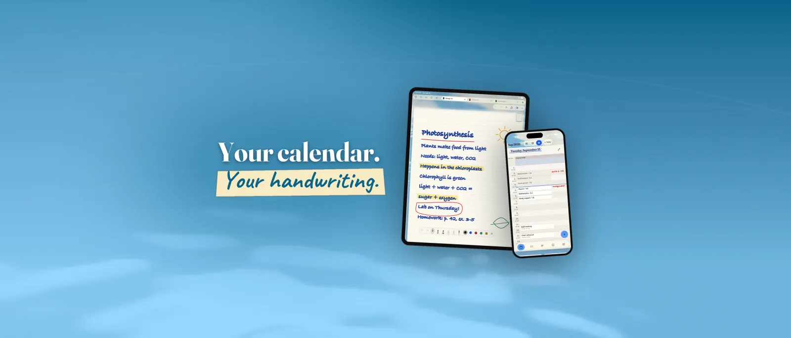
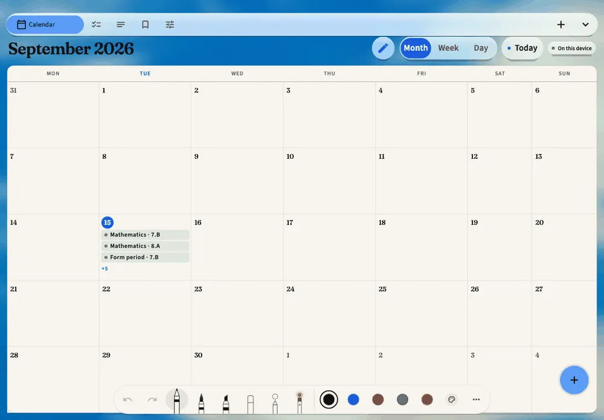
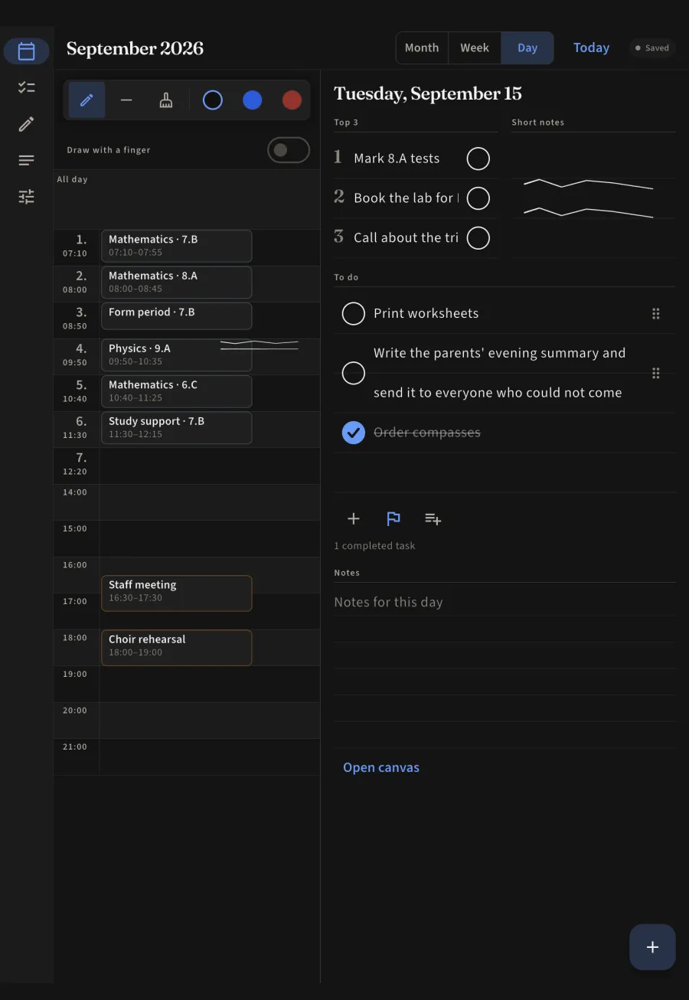
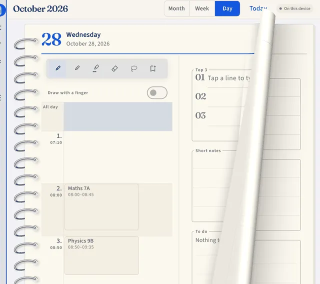

# NorthStar Planner

**Your calendar. Your handwriting. One app.**

[Slovenščina](README.sl.md) · [The story](docs/journey/01-the-question.md) · [How it works](docs/how-it-works.md) · [Timeline](docs/timeline.md) · [Screenshots](docs/screenshots.md)

> **The app's source code is closed.** This repository is where I tell how NorthStar Planner got made, and where the public builds live. The app's code is not in here.

NorthStar Planner is a planner for iPad, iPhone, Mac, Android, Windows and the web. It shows the calendar you already use (Outlook, Google, or any calendar link) and lets you write right next to it. Each day has a Top 3, a to-do list, typed notes, and handwriting with Apple Pencil, a stylus or a finger. Notebooks, a whiteboard, stickers and PDFs are in the same app. It all syncs between your devices through my own server, and your notes are never written back into your calendar.

My mum is a teacher. She wanted her school timetable and her notes in one place, on every device she owns. That's how this started.

---

## What it does

| | |
|---|---|
| **Calendar** | Month, Week and Day views of your Outlook, Google and calendar-link calendars, with a lesson grid for school hours. |
| **Day planning** | Top 3, to-do list, short notes and a full notes page beside every day. |
| **Handwriting** | Write on the timetable, in notebooks and on a whiteboard. Pens, highlighter, eraser, lasso, laser pointer, shapes. |
| **Notebooks** | Covers, many paper types, page curl or scroll, tabs, PDF import, export to PDF, image or a notebook file. |
| **Tasks** | Folders, lists, smart lists, flags, sub-tasks, and "put it on a day". |
| **Widgets** | Home Screen widgets for today, next event, Top 3, to-dos and notebooks. |
| **Looks** | Classic paper design or the new Glass design, light and dark, your own background. |
| **Sync** | Works offline and catches up when you're back online. It tells you what has been sent and what hasn't. |
| **Ask AI** | Ask AI with your own API key (optional, off by default). |
| **Languages** | English and Slovenian. |

---

## Download

| Platform | Where | Notes |
|---|---|---|
| iPhone and iPad | [App Store](https://apps.apple.com/app/id6831786463) | iOS / iPadOS 26 or newer. |
| Mac | [App Store](https://apps.apple.com/app/id6831786463) or a zip from [Releases](https://github.com/majmohar4/NorthStar-Planner/releases) | The direct zip is unsigned, see below. |
| Android | [Google Play](https://play.google.com/store/apps/details?id=eu.majmohar.northstar) (closed testing, ask to join) or an APK from [Releases](https://github.com/majmohar4/NorthStar-Planner/releases) | |
| Web | [app-northstar.majmohar.eu](https://app-northstar.majmohar.eu) | Any modern browser. Installable as an app. |
| Windows | Coming soon | A Windows build will be added to [Releases](https://github.com/majmohar4/NorthStar-Planner/releases) soon (unsigned, see below). |
| Linux | tar.gz from [Releases](https://github.com/majmohar4/NorthStar-Planner/releases) | x64. Needs a system keyring (for example GNOME Keyring) and xdg-user-dirs. |

Landing page: [northstar.majmohar.eu](https://northstar.majmohar.eu)

### Install notes

- **Android APK:** download the `.apk`, open it, and allow "Install unknown apps" for your browser or file manager when Android asks. After that the app checks for updates on its own.
- **Windows:** unzip the folder anywhere and run `northstar.exe`. I haven't code-signed the build, so Windows SmartScreen may complain. Click **More info → Run anyway**.
- **macOS (direct zip):** unzip and move NorthStar to Applications. The build is not notarized, so the first time you have to **right-click the app → Open** and confirm. The App Store version needs none of this.
- **Web:** just open the link. In Safari on iPad use Share → Add to Home Screen. In Chrome or Edge use the install icon in the address bar.

The builds are on the [Releases](https://github.com/majmohar4/NorthStar-Planner/releases) page, never inside this repository.

---

## The story in short

It took about three months to get from a blank page to a released app (August to November 2026). That's around 1,300 commits and more than 100 releases. I wrote the whole thing down in eleven chapters:

1. [The question](docs/journey/01-the-question.md). Can writing on a blank page in Flutter feel as good as in a native app or on the web?
2. [Mum's idea](docs/journey/02-mums-idea.md). A timetable she can draw on, synced with her calendars. Then it grew.
3. [The first prototype](docs/journey/03-first-prototype.md). It worked, mostly. Bugs included.
4. [Sync and the server](docs/journey/04-sync-and-the-server.md). The hardest part, and the one that humbled me most.
5. [The calendar](docs/journey/05-calendar.md). Outlook, Google, calendar links and a school timetable.
6. [Handwriting and notebooks](docs/journey/06-handwriting-and-notebooks.md). Two ink engines, then one, and the long page curl saga.
7. [Design and Glass](docs/journey/07-design-and-glass.md). How I banned glass in August and shipped it in November.
8. [Widgets and everywhere](docs/journey/08-widgets-and-everywhere.md). iOS, Android, Mac, Windows, web.
9. [Polish and feedback rounds](docs/journey/09-polish-and-feedback-rounds.md). Living with a real user, mainly my mum.
10. [Release](docs/journey/10-release.md). Stores, review, landing page, promo video.
11. [What's next](docs/journey/11-whats-next.md)

If you only want the pictures, [Screenshots](docs/screenshots.md#how-it-looked-over-time) has one per version, from the empty first build in August to 3.6.

| August (0.x) | October (2.1) | November (3.3, Glass) |
|---|---|---|
|  |  |  |

---

## Under the hood (short)

The whole app is one codebase in Flutter and Dart, built for iOS, iPadOS, macOS, Android, Windows and the web. Behind it is my own backend: a Dart sync server, a database and a sign-in service, running on a small home server.

Every device keeps a full local copy and syncs changes in the background, so it works offline. Handwriting goes through my own ink engine, which looks the same on every platform and supports Apple Pencil on iPad. The Home Screen widgets are the one bigger piece written natively, for iOS and for Android.

More in [How it works](docs/how-it-works.md).

---

## Made by

I'm Maj Mohar, a student from Slovenia. I built NorthStar for my mum, and for anyone else who lives by a calendar.

I used Claude Code as a tool to help build the app.

There's also **Tasky**, my small to-do app. It shares the task structure and the Glass look with NorthStar.

## License

All rights reserved. The NorthStar Planner source code is closed. Text, images and builds in this repository may not be redistributed or modified without permission. See [LICENSE](LICENSE).
