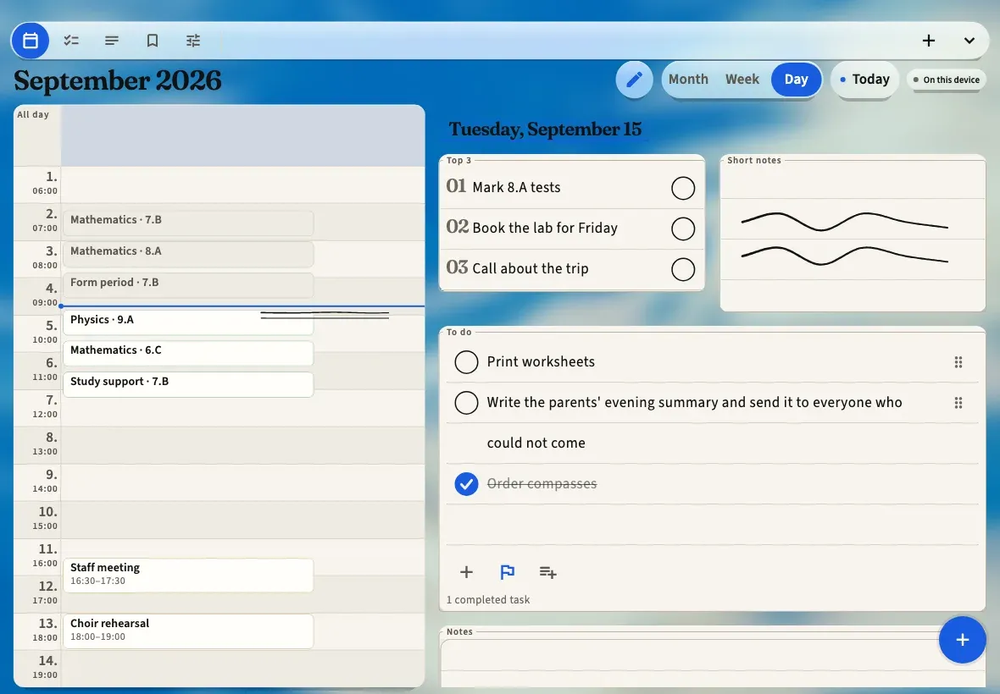

# NorthStar Planner

**Your calendar. Your handwriting. One app.**

[Slovenščina](README.sl.md) · [The journey](docs/journey/01-the-question.md) · [How it works](docs/how-it-works.md) · [Timeline](docs/timeline.md) · [Screenshots](docs/screenshots.md)

> **The app's source code is closed.** This repository tells the story of how NorthStar Planner was made and hosts the public builds. It does not contain the app's code.

NorthStar Planner is a planner for iPad, iPhone, Mac, Android, Windows and the web. It mirrors the calendar you already use (Outlook, Google, or any calendar link), and lets you write right next to it: a Top 3 for the day, a to-do list, typed notes, and handwriting with Apple Pencil, a stylus, or a finger. Notebooks, a whiteboard, stickers and PDFs live in the same app. Everything syncs between your devices through my own server, and your notes are never written back into your calendar.

It started as an idea from my mum, a teacher, who wanted one place for her school timetable and her notes, on every device she owns.

---

## What it does

| | |
|---|---|
| **Calendar** | Month, Week and Day views of your Outlook, Google and calendar-link calendars, with a lesson grid for school hours. |
| **Day planning** | Top 3, to-do list, short notes and a full notes page beside every day. |
| **Handwriting** | Write on the timetable, in notebooks and on a whiteboard. Pens, highlighter, eraser, lasso, laser pointer, shapes. |
| **Notebooks** | Covers, many paper types, page curl or scroll, tabs, PDF import, export to PDF, image or a notebook file. |
| **Tasks** | Folders, lists, smart lists, flags, sub-tasks, and "put it on a day". |
| **Widgets** | Home Screen widgets for today, next event, Top 3, to-dos and notebooks. |
| **Looks** | Classic paper design or the new Glass design, light and dark, your own background. |
| **Sync** | Works offline, catches up when you are back online, shows honestly what has and has not been sent. |
| **Ask AI** | Ask AI with your own API key (optional, off by default). |
| **Languages** | English and Slovenian. |

---

## Download

| Platform | Where | Notes |
|---|---|---|
| iPhone and iPad | [App Store](https://apps.apple.com/app/id6831786463) | iOS / iPadOS 26 or newer. |
| Mac | [App Store](https://apps.apple.com/app/id6831786463) or a zip from [Releases](https://github.com/majmohar4/NorthStar-Planner/releases) | The direct zip is unsigned, see below. |
| Android | [Google Play](https://play.google.com/store/apps/details?id=eu.majmohar.northstar) (closed testing, ask to join) or an APK from [Releases](https://github.com/majmohar4/NorthStar-Planner/releases) | |
| Web | [app-northstar.majmohar.eu](https://app-northstar.majmohar.eu) | Any modern browser. Installable as an app. |
| Windows | zip from [Releases](https://github.com/majmohar4/NorthStar-Planner/releases) | Unsigned, see below. |
| Linux | Coming soon | A Linux build will be added to [Releases](https://github.com/majmohar4/NorthStar-Planner/releases) later. |

Landing page: [northstar.majmohar.eu](https://northstar.majmohar.eu)

### Install notes

- **Android APK:** download the `.apk`, open it, and allow "Install unknown apps" for your browser or file manager when Android asks. The app checks for updates itself.
- **Windows:** unzip the folder anywhere and run `northstar.exe`. The build is not code-signed, so Windows SmartScreen may warn you: click **More info → Run anyway**.
- **macOS (direct zip):** unzip and move NorthStar to Applications. The build is not notarized, so the first time **right-click the app → Open**, then confirm. The App Store version needs none of this.
- **Web:** open the link. In Safari on iPad use Share → Add to Home Screen, in Chrome or Edge use the install icon in the address bar.

Binaries are published on the [Releases](https://github.com/majmohar4/NorthStar-Planner/releases) page, never inside this repository.

---

## The journey in short

From a blank page to a released app in about three months (August to November 2026), around 1,300 commits and more than 100 releases.

1. [**The question**](docs/journey/01-the-question.md): can you write on a blank page in Flutter as nicely as in a native app or on the web?
2. [**Mum's idea**](docs/journey/02-mums-idea.md): one app for the calendar, the notebooks and the documents, synced everywhere.
3. [**The first prototype**](docs/journey/03-first-prototype.md): it worked, mostly. With all its bugs.
4. [**Sync and the server**](docs/journey/04-sync-and-the-server.md): the hardest part, and the most humbling.
5. [**The calendar**](docs/journey/05-calendar.md): Outlook, Google, calendar links, and a school timetable.
6. [**Handwriting and notebooks**](docs/journey/06-handwriting-and-notebooks.md): two ink engines, then one, and the long page curl story.
7. [**Design and Glass**](docs/journey/07-design-and-glass.md): from Classic paper to the Glass redesign.
8. [**Widgets and everywhere**](docs/journey/08-widgets-and-everywhere.md): iOS, Android, Mac, Windows, web.
9. [**Polish and feedback rounds**](docs/journey/09-polish-and-feedback-rounds.md): living with real users, mainly my mum.
10. [**Release**](docs/journey/10-release.md): stores, review, landing page, promo video.
11. [**What's next**](docs/journey/11-whats-next.md)

**How it looked over time:** one picture per version, from the empty first build in August to 3.6, in [Screenshots](docs/screenshots.md#how-it-looked-over-time).

| August (0.x) | October (2.1) | November (3.3, Glass) |
|---|---|---|
|  |  |  |

---

## Under the hood (short)

- **One codebase** in Flutter and Dart for iOS, iPadOS, macOS, Android, Windows and the web.
- **My own backend:** a Dart sync server, a database and a sign-in service, running on a small home server.
- **Offline first:** every device keeps a full local copy and syncs changes in the background.
- **Own ink engine** for handwriting that looks the same on every platform, with Apple Pencil support on iPad.
- **Home Screen widgets** written natively for iOS and Android.

More in [How it works](docs/how-it-works.md).

---

## Made by

Built by Maj Mohar, a student in Slovenia, for his mum and for anyone who lives by a calendar.

I used Claude Code as a tool to help build the app.

Companion app: **Tasky**, my small to-do app, shares the task structure and the Glass look.

## License

All rights reserved. The NorthStar Planner source code is closed. Text, images and builds in this repository may not be redistributed or modified without permission. See [LICENSE](LICENSE).
