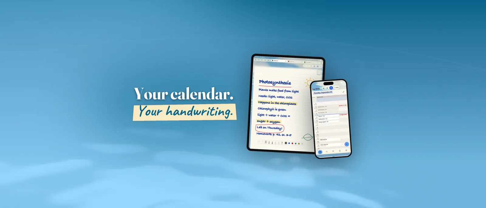
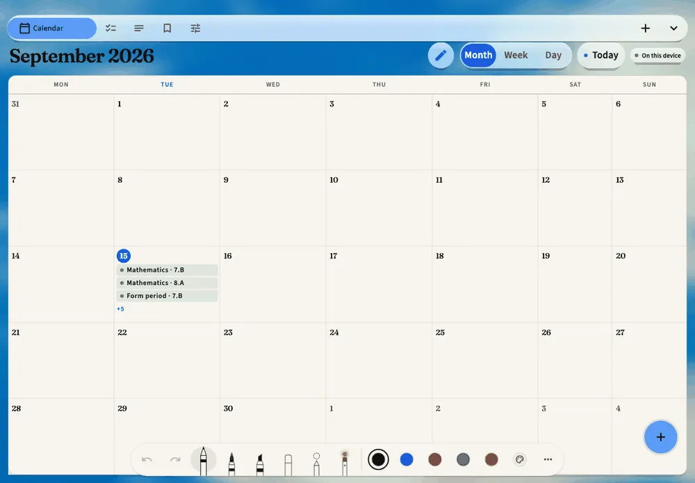
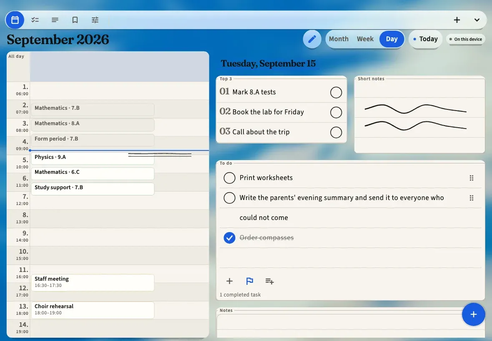

# NorthStar Planner

**Tvoj koledar. Tvoja pisava. Ena aplikacija.**

[English](README.md) · [Zgodba (angleško)](docs/journey/01-the-question.md) · [Kako deluje (angleško)](docs/how-it-works.md) · [Časovnica](docs/timeline.md) · [Posnetki zaslona](docs/screenshots.md)

> **Izvorna koda aplikacije je zaprta.** Tukaj sem zapisal, kako je NorthStar Planner nastajal, in sem nalagam različice za prenos. Kode aplikacije tu ni.

NorthStar Planner je planer za iPad, iPhone, Mac, Android, Windows in splet. Pokaže ti koledar, ki ga že imaš (Outlook, Google ali katerokoli povezavo do koledarja), ti pa pišeš kar zraven. Vsak dan ima svoj Top 3, seznam opravil, tipkane zapiske in rokopis z Apple Pencilom, pisalom ali kar s prstom. V isti aplikaciji so še zvezki, tabla, nalepke in PDF-ji. Vse se sinhronizira med tvojimi napravami prek mojega strežnika, zapiski pa se nikoli ne zapišejo nazaj v tvoj koledar.

Moja mama je učiteljica. Hotela je imeti šolski urnik in svoje zapiske na enem mestu, na vseh napravah, ki jih uporablja. Tako se je začelo.

---

## Kaj zna

| | |
|---|---|
| **Koledar** | Mesečni, tedenski in dnevni pogled na koledarje iz Outlooka, Googla in povezav, z mrežo šolskih ur. |
| **Načrtovanje dneva** | Top 3, seznam opravil, kratki zapiski in cela stran za zapiske ob vsakem dnevu. |
| **Rokopis** | Pišeš po urniku, v zvezke in na tablo. Peresa, označevalnik, radirka, laso, laserski kazalnik, oblike. |
| **Zvezki** | Platnice, veliko vrst papirja, listanje ali drsenje, zavihki, uvoz PDF, izvoz v PDF, sliko ali datoteko zvezka. |
| **Opravila** | Mape, seznami, pametni seznami, zastavice, podopravila in »postavi na dan«. |
| **Pripomočki** | Pripomočki na začetnem zaslonu za danes, naslednji dogodek, Top 3, opravila in zvezke. |
| **Videz** | Klasičen papirnat videz ali novi stekleni (Glass), svetel in temen, s tvojim ozadjem. |
| **Sinhronizacija** | Dela tudi brez povezave in nadoknadi, ko si spet na spletu. Vedno ti pove, kaj je že poslano in kaj še ne. |
| **Vprašaj AI** | Vprašaj AI z lastnim API ključem (neobvezno, privzeto izklopljeno). |
| **Jeziki** | Angleščina in slovenščina. |

---

## Prenos

| Platforma | Kje | Opombe |
|---|---|---|
| iPhone in iPad | [App Store](https://apps.apple.com/app/id6831786463) | iOS / iPadOS 26 ali novejši. |
| Mac | [App Store](https://apps.apple.com/app/id6831786463) ali zip na strani [Releases](https://github.com/majmohar4/NorthStar-Planner/releases) | Zip ni podpisan, glej spodaj. |
| Android | [Google Play](https://play.google.com/store/apps/details?id=eu.majmohar.northstar) (zaprto testiranje, piši mi, če hočeš zraven) ali APK na strani [Releases](https://github.com/majmohar4/NorthStar-Planner/releases) | |
| Splet | [app-northstar.majmohar.eu](https://app-northstar.majmohar.eu) | Katerikoli sodoben brskalnik. Lahko si jo namestiš kot aplikacijo. |
| Windows | Kmalu | Različica za Windows pride kmalu na stran [Releases](https://github.com/majmohar4/NorthStar-Planner/releases) (ne bo podpisana, glej spodaj). |
| Linux | tar.gz na strani [Releases](https://github.com/majmohar4/NorthStar-Planner/releases) | x64. Rabi sistemski keyring (recimo GNOME Keyring) in xdg-user-dirs. |

Predstavitvena stran: [northstar.majmohar.eu](https://northstar.majmohar.eu)

### Navodila za namestitev

- **Android APK:** prenesi datoteko `.apk`, odpri jo in dovoli »Nameščanje neznanih aplikacij« za brskalnik ali upravitelja datotek, ko te Android vpraša. Potem aplikacija sama preverja posodobitve.
- **Windows:** razpakiraj mapo, kamor hočeš, in zaženi `northstar.exe`. Različica ni podpisana, zato se lahko oglasi Windows SmartScreen. Klikni **Več informacij → Vseeno zaženi** (angleško *More info → Run anyway*).
- **macOS (zip):** razpakiraj in premakni NorthStar v mapo Aplikacije. Različica ni overjena pri Applu, zato jo moraš prvič odpreti tako, da **z desnim gumbom klikneš aplikacijo → Odpri** in potrdiš. Pri različici iz App Stora tega ni treba.
- **Splet:** samo odpri povezavo. V Safariju na iPadu izberi Deli → Dodaj na začetni zaslon, v Chromu ali Edgu pa klikni ikono za namestitev v naslovni vrstici.

Datoteke za prenos so na strani [Releases](https://github.com/majmohar4/NorthStar-Planner/releases), nikoli v samem repozitoriju.

---

## Zgodba na kratko

Od prazne strani do objavljene aplikacije so minili približno trije meseci (od avgusta do novembra 2026). Vmes se je nabralo okoli 1.300 sprememb v kodi in več kot 100 izdaj. Celo zgodbo sem napisal v angleščini, tukaj je kratka verzija.

### 1. Vprašanje: prazna stran

Najprej me je skrbelo samo eno: pisanje z Apple Pencilom mora biti prijetno, sicer vse ostalo nima smisla. Zato sem isto prazno stran naredil trikrat, kot izvorno aplikacijo za iPad, v Flutterju in na spletu. Potem sem čečkal po vseh treh in gledal, koliko črta zaostaja za pisalom. Izvorna različica je zmagala brez težav, zato so prve različice NorthStarja na Applovih napravah uporabljale Applovo pisanje. Ko so prišli zvezki, pa to ni bilo več dovolj uporabno. Počasi sem ga umikal in ga 6. septembra odstranil. Potem sem toliko časa pilil Flutterjevo tablo, da je pisanje prišlo zelo blizu Applovim Beležkam. [Več](docs/journey/01-the-question.md)

### 2. Mamina ideja

Mama si je zaželela aplikacijo z urnikom, po katerem lahko riše, usklajeno z Googlovim in Outlookovim koledarjem. Potem je projekt kar rasel, ker sem sproti dobival ideje in videl, kaj vse se da narediti. Prva dva dneva nisem napisal nič kode, samo načrtoval sem: opis izdelka, podatke, pravila sinhronizacije, mejnike in pravila za videz. [Več](docs/journey/02-mums-idea.md)

### 3. Prvi prototip

Prvo različico je mama dobila na iPad 28. avgusta, en teden po prvem načrtu. Delala je. Večinoma. Opombe ob izdajah iz tistih tednov se berejo kot dnevnik napak: črnilo na napačni strani, prazna spletna aplikacija, nastavitve, ki se niso sinhronizirale. Takrat sem ugotovil, da so najhujše tiste napake, ki so tiho. [Več](docs/journey/03-first-prototype.md)

### 4. Sinhronizacija in strežnik

Svoj strežnik, svoja baza in svoja prijava, vse na majhnem domačem strežniku. Vsaka naprava ima celotno kopijo in dela tudi brez povezave. Napake so bile zahrbtne. Dve napravi sta se tiho nehali sinhronizirati. Ena sama slika je ustavila celo vrsto. Pisalo je »Shranjeno«, pa ni bilo. Zdaj aplikacija vedno pove po resnici, kaj je poslano in kaj ne. [Več](docs/journey/04-sync-and-the-server.md)

### 5. Koledar

NorthStar ne nadomešča tvojih koledarjev, samo pokaže jih: povezave do koledarjev, Google koledar, datoteke in dogodke, ki jih narediš v aplikaciji. Zraven je mreža šolskih ur s pravimi časi zvonjenja. Zapiski pa ne gredo nikoli nazaj v koledar. [Več](docs/journey/05-calendar.md)

### 6. Rokopis in zvezki

Na začetku sta bila dva pogona za pisanje, Applov in moj. Kar si napisal z Applovim, se drugje ni dalo urejati, zato sem ga 6. septembra odstranil. Podpora za Apple Pencil je seveda ostala. Potem pa dolga zgodba o listanju strani: od pravila »brez zavihanih strani« do pravega 3D zavihka, odprte knjige in novega pravila, da se videz zavihka nikoli ne spremeni po nesreči. [Več](docs/journey/06-handwriting-and-notebooks.md)

### 7. Oblikovanje in Glass

Moja prva pravila so steklen, zamegljen videz izrecno prepovedala. Novembra je bila aplikacija že pretežka za oko, zato sem si premislil: gumbi in vrstice lebdijo na steklu, strani ostanejo papir. Osem krogov popravkov v petih dneh, potem pa različica 3.3.0. [Več](docs/journey/07-design-and-glass.md)

### 8. Pripomočki in vse naprave

iPad, iPhone, splet, Android, Mac in Windows iz ene kode. Pripomočki na začetnem zaslonu so prišli že dvanajst dni po prvi spremembi v kodi. Največ sivih las mi je naredilo pisalo na Windows prenosniku v brskalniku. To sem rešil šele, ko sem testiral na pravi napravi. [Več](docs/journey/08-widgets-and-everywhere.md)

### 9. Dodelava in krogi popravkov

Ena prava, zahtevna uporabnica je vredna več kot sto izmišljenih. Delal sem v krogih: seznam vsega, kar sva z mamo nabrala, potem delo v enem zamahu, izdaja in nekaj dni uporabe. Vsaka napaka, ki jo najdeva, se popravi. [Več](docs/journey/09-polish-and-feedback-rounds.md)

### 10. Izdaja

Predstavitvena stran, slike za trgovine in App Store, kjer so mi prvo oddajo vrnili in zahtevali posnetek zaslona celotne uporabe. Na Google Play je aplikacija zaenkrat v zaprtem testiranju. Promocijski video še pride. [Več](docs/journey/10-release.md)

### 11. Kaj sledi

Javna objava na Google Play, novi krogi popravkov, podpisane namizne različice in še kup idej. [Več](docs/journey/11-whats-next.md)

Če te zanimajo samo slike: v [galeriji](docs/screenshots.md#how-it-looked-over-time) je po ena za vsako različico, od prazne prve avgusta do 3.6.

| Avgust (0.x) | Oktober (2.1) | November (3.3, Glass) |
|---|---|---|
|  |  |  |

---

## Pod pokrovom (na kratko)

Cela aplikacija je ena koda v Flutterju in Dartu, iz katere nastanejo različice za iOS, iPadOS, macOS, Android, Windows in splet. Za njo stoji moj zaledni sistem: strežnik za sinhronizacijo v Dartu, baza podatkov in storitev za prijavo, vse na majhnem domačem strežniku.

Vsaka naprava ima celotno lokalno kopijo in spremembe pošilja v ozadju, zato dela tudi brez povezave. Za rokopis skrbi moj pogon za pisanje, ki je enak na vseh platformah in na iPadu podpira Apple Pencil. Pripomočki na začetnem zaslonu so napisani posebej za iOS in posebej za Android.

Več v dokumentu [Kako deluje](docs/how-it-works.md) (angleško).

---

## Avtor

Sem Maj Mohar, študent iz Slovenije. NorthStar sem naredil za mamo in za vse ostale, ki živijo po koledarju.

I used Claude Code as a tool to help build the app. (Pri izdelavi aplikacije sem si pomagal z orodjem Claude Code.)

Imam še **Tasky**, svojo majhno aplikacijo za opravila. Z NorthStarjem si deli zgradbo opravil in stekleni videz.

## Licenca

Vse pravice pridržane. Izvorna koda aplikacije NorthStar Planner je zaprta. Besedil, slik in različic za prenos v tem repozitoriju ni dovoljeno razširjati ali spreminjati brez dovoljenja. Glej [LICENSE](LICENSE).
