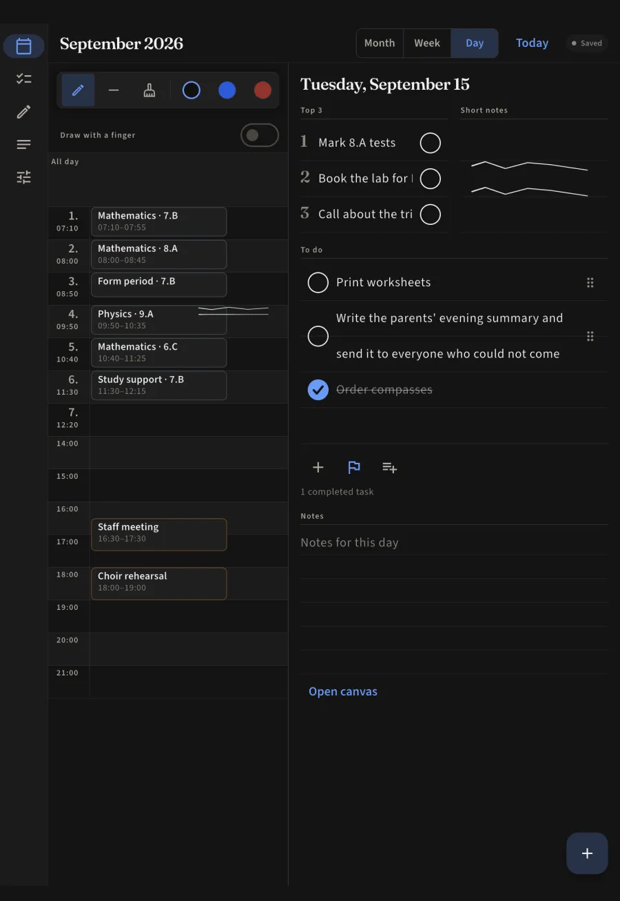
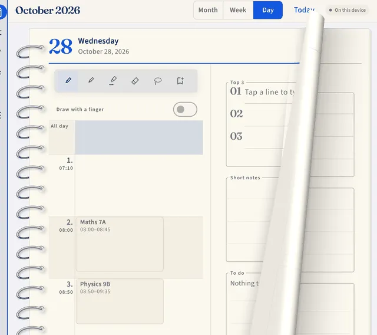

# NorthStar Planner

**Tvoj koledar. Tvoja pisava. Ena aplikacija.**

[English](README.md) · [Pot (angleško)](docs/journey/01-the-question.md) · [Kako deluje (angleško)](docs/how-it-works.md) · [Časovnica](docs/timeline.md) · [Posnetki zaslona](docs/screenshots.md)

> **Izvorna koda aplikacije je zaprta.** Ta repozitorij pripoveduje zgodbo o tem, kako je NorthStar Planner nastal, in gosti javne različice za prenos. Kode aplikacije ne vsebuje.

NorthStar Planner je planer za iPad, iPhone, Mac, Android, Windows in splet. Prikazuje koledar, ki ga že uporabljaš (Outlook, Google ali katerokoli povezavo do koledarja), in ti omogoča, da pišeš kar zraven: Top 3 za dan, seznam opravil, tipkane zapiske in rokopis z Apple Pencilom, pisalom ali prstom. V isti aplikaciji so tudi zvezki, tabla, nalepke in PDF-ji. Vse se sinhronizira med napravami prek mojega lastnega strežnika, tvoji zapiski pa se nikoli ne zapišejo nazaj v koledar.

Začelo se je z idejo moje mame, učiteljice, ki je želela imeti šolski urnik in svoje zapiske na enem mestu, na vseh napravah, ki jih uporablja.

---

## Kaj zna

| | |
|---|---|
| **Koledar** | Mesečni, tedenski in dnevni pogled na koledarje iz Outlooka, Googla in povezav, z mrežo šolskih ur. |
| **Načrtovanje dneva** | Top 3, seznam opravil, kratki zapiski in cela stran za zapiske ob vsakem dnevu. |
| **Rokopis** | Pisanje po urniku, v zvezkih in na tabli. Peresa, označevalnik, radirka, laso, laserski kazalnik, oblike. |
| **Zvezki** | Platnice, veliko vrst papirja, obračanje strani ali drsenje, zavihki, uvoz PDF, izvoz v PDF, sliko ali datoteko zvezka. |
| **Opravila** | Mape, seznami, pametni seznami, zastavice, podopravila in »postavi na dan«. |
| **Pripomočki** | Pripomočki na začetnem zaslonu za danes, naslednji dogodek, Top 3, opravila in zvezke. |
| **Videz** | Klasičen papirnat videz ali novi steklen videz (Glass), svetel in temen, z lastnim ozadjem. |
| **Sinhronizacija** | Deluje brez povezave, ob vrnitvi na splet dohiti zamujeno in pošteno pokaže, kaj je že poslano in kaj še ne. |
| **Vprašaj AI** | Vprašaj AI z lastnim API ključem (neobvezno, privzeto izklopljeno). |
| **Jeziki** | Angleščina in slovenščina. |

---

## Prenos

| Platforma | Kje | Opombe |
|---|---|---|
| iPhone in iPad | [App Store](https://apps.apple.com/app/id6831786463) | iOS / iPadOS 26 ali novejši. |
| Mac | [App Store](https://apps.apple.com/app/id6831786463) ali zip na strani [Releases](https://github.com/majmohar4/NorthStar-Planner/releases) | Neposredni zip ni podpisan, glej spodaj. |
| Android | [Google Play](https://play.google.com/store/apps/details?id=eu.majmohar.northstar) (zaprto testiranje, piši mi, če se želiš pridružiti) ali APK na strani [Releases](https://github.com/majmohar4/NorthStar-Planner/releases) | |
| Splet | [app-northstar.majmohar.eu](https://app-northstar.majmohar.eu) | Katerikoli sodoben brskalnik. Lahko ga namestiš kot aplikacijo. |
| Windows | Kmalu | Različica za Windows bo kmalu dodana na stran [Releases](https://github.com/majmohar4/NorthStar-Planner/releases) (ni podpisana, glej spodaj). |
| Linux | tar.gz na strani [Releases](https://github.com/majmohar4/NorthStar-Planner/releases) | x64. Potrebuje sistemski keyring (na primer GNOME Keyring) in xdg-user-dirs. |

Predstavitvena stran: [northstar.majmohar.eu](https://northstar.majmohar.eu)

### Navodila za namestitev

- **Android APK:** prenesi datoteko `.apk`, jo odpri in dovoli »Nameščanje neznanih aplikacij« za brskalnik ali upravitelja datotek, ko te Android vpraša. Aplikacija sama preverja posodobitve.
- **Windows:** razpakiraj mapo kamorkoli in zaženi `northstar.exe`. Različica ni podpisana, zato te lahko Windows SmartScreen opozori: klikni **Več informacij → Vseeno zaženi** (angleško *More info → Run anyway*).
- **macOS (neposredni zip):** razpakiraj in premakni NorthStar v mapo Aplikacije. Različica ni overjena pri Applu, zato jo prvič odpri tako, da **z desnim klikom klikneš aplikacijo → Odpri** in potrdiš. Različica iz App Stora tega ne potrebuje.
- **Splet:** odpri povezavo. V Safariju na iPadu izberi Deli → Dodaj na začetni zaslon, v Chromu ali Edgu pa ikono za namestitev v naslovni vrstici.

Datoteke za prenos so objavljene na strani [Releases](https://github.com/majmohar4/NorthStar-Planner/releases), nikoli v samem repozitoriju.

---

## Pot na kratko

Od prazne strani do objavljene aplikacije v približno treh mesecih (od avgusta do novembra 2026), s približno 1.300 spremembami v kodi in več kot 100 izdajami. Podrobna zgodba je v angleščini, tukaj je povzetek.

### 1. Vprašanje: prazna stran

Vse je bilo odvisno od enega: pisanje z Apple Pencilom mora biti prijetno. Zato sem isto prazno stran naredil trikrat, kot izvorno aplikacijo za iPad, v Flutterju in na spletu, ter primerjal zamik črte za pisalom. Izvorna različica je bila očitno najboljša, zato so prve različice NorthStarja na Applovih napravah uporabljale Applovo pisanje. Ko sem dodajal zvezke, ta način ni bil dovolj uporaben, zato sem ga postopoma umaknil in 6. septembra odstranil. Nato sem Flutterjevo tablo optimiziral, dokler pisanje ni bilo zelo blizu Applovi aplikaciji Beležke. [Več](docs/journey/01-the-question.md)

### 2. Mamina ideja

Mama je učiteljica. Želela je aplikacijo z urnikom, po katerem lahko riše, sinhronizirano z Googlovim in Outlookovim koledarjem. Potem je projekt rasel, ker sem dobival nove ideje in videl, da so izvedljive. Dva dneva sem samo načrtoval: opis izdelka, podatke, pravila sinhronizacije, mejnike in oblikovna pravila. [Več](docs/journey/02-mums-idea.md)

### 3. Prvi prototip

Prva različica, ki jo je mama dobila na iPad, je izšla 28. avgusta, en teden po prvem načrtu. Delovala je, večinoma. Opombe ob izdajah iz tistih tednov se berejo kot dnevnik napak: črnilo na napačni strani, prazna spletna aplikacija, nastavitve, ki se niso sinhronizirale. Naučil sem se, da so tihe napake najhujše. [Več](docs/journey/03-first-prototype.md)

### 4. Sinhronizacija in strežnik

Lasten strežnik, lastna baza in lastna prijava, vse na majhnem domačem strežniku. Vsaka naprava ima celotno kopijo in deluje brez povezave. Napake so bile zahrbtne: napravi, ki sta tiho prenehali s sinhronizacijo, ena slika, ki je zaustavila celo vrsto, in znak »Shranjeno«, ko ni bilo shranjeno. Zdaj aplikacija vedno pove resnico. [Več](docs/journey/04-sync-and-the-server.md)

### 5. Koledar

NorthStar koledarjev ne nadomešča, temveč jih prikazuje: povezave do koledarjev, Google koledar, datoteke in lastni dogodki. Mreža šolskih ur s pravimi časi zvonjenja. Zapiski se nikoli ne zapišejo nazaj v koledar. [Več](docs/journey/05-calendar.md)

### 6. Rokopis in zvezki

Najprej sta bila dva pogona za pisanje, Applov in moj lastni. Applov zapis se drugje ni dal urejati, zato sem ga 6. septembra odstranil, podpora za Apple Pencil pa je ostala. Sledila je dolga zgodba o obračanju strani: od pravila »brez zavihanih strani« do pravega 3D zavihka, odprte knjige in pravila, da se videz zavihka nikoli ne spremeni po nesreči. [Več](docs/journey/06-handwriting-and-notebooks.md)

### 7. Oblikovanje in Glass

Prva pravila so prepovedovala prav steklen, zamegljen videz. Novembra je aplikacija postala pretežka za oko, zato sem pravilo spremenil: gumbi in vrstice lebdijo na steklu, strani ostanejo papir. Osem krogov popravkov v petih dneh in različica 3.3.0. [Več](docs/journey/07-design-and-glass.md)

### 8. Pripomočki in vse naprave

iPad, iPhone, splet, Android, Mac in Windows iz ene kode. Pripomočki na začetnem zaslonu že dvanajst dni po prvi spremembi. Pisalo na Windows prenosniku v brskalniku je prineslo svoje težave, ki sem jih rešil šele s testiranjem na pravi napravi. [Več](docs/journey/08-widgets-and-everywhere.md)

### 9. Dodelava in krogi povratnih informacij

Ena prava, zahtevna uporabnica je vredna več kot sto namišljenih. Delo je potekalo v krogih: seznam vsega, kar sva z mamo zbrala, en zalet, izdaja in nekaj dni uporabe. Vsaka najdena napaka se popravi. [Več](docs/journey/09-polish-and-feedback-rounds.md)

### 10. Izdaja

Predstavitvena stran, slike za trgovine, App Store, kjer je pregled prvič zahteval posnetek zaslona celotne uporabe, in Google Play z zaprtim testiranjem. Promocijski video prihaja. [Več](docs/journey/10-release.md)

### 11. Kaj sledi

Javna objava na Google Play, več krogov povratnih informacij, podpisane namizne različice in nove ideje. [Več](docs/journey/11-whats-next.md)

**Kako se je spreminjala:** po ena slika za vsako različico, od prazne prve različice avgusta do 3.6, v [galeriji](docs/screenshots.md#how-it-looked-over-time).

| Avgust (0.x) | Oktober (2.1) | November (3.3, Glass) |
|---|---|---|
|  |  |  |

---

## Pod pokrovom (na kratko)

- **Ena koda** v Flutterju in Dartu za iOS, iPadOS, macOS, Android, Windows in splet.
- **Lasten zaledni sistem:** strežnik za sinhronizacijo v Dartu, baza podatkov in storitev za prijavo na majhnem domačem strežniku.
- **Najprej brez povezave:** vsaka naprava hrani celotno lokalno kopijo in spremembe sinhronizira v ozadju.
- **Lasten pogon za rokopis**, ki je enak na vseh platformah, s podporo za Apple Pencil na iPadu.
- **Pripomočki na začetnem zaslonu**, napisani posebej za iOS in Android.

Več v dokumentu [Kako deluje](docs/how-it-works.md) (angleško).

---

## Avtor

Aplikacijo je naredil Maj Mohar, študent iz Slovenije, za svojo mamo in za vse, ki živijo po koledarju.

I used Claude Code as a tool to help build the app. (Pri izdelavi aplikacije sem si pomagal z orodjem Claude Code.)

Spremljevalna aplikacija: **Tasky**, moja majhna aplikacija za opravila, ima enako zgradbo opravil in steklen videz.

## Licenca

Vse pravice pridržane. Izvorna koda aplikacije NorthStar Planner je zaprta. Besedil, slik in različic za prenos v tem repozitoriju ni dovoljeno razširjati ali spreminjati brez dovoljenja. Glej [LICENSE](LICENSE).
