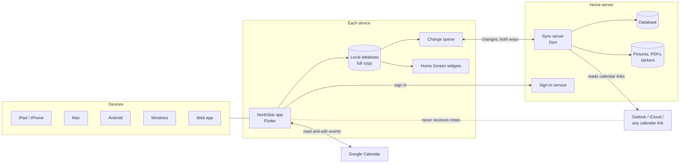

# How NorthStar works

[Back to README](../README.md)

This is a tour of the main ideas, without the source code. NorthStar's source is closed, so I explain what happens and why, and leave out exactly how it's written.

## The big picture

## One app, every platform

I wrote the whole app once, in Flutter and Dart, and it builds for iPhone, iPad, Mac, Android, Windows and the web. Only small pieces are native: the Home Screen widgets (Swift for iOS, Kotlin for Android), notifications, share sheets, file pickers and the Apple Pencil squeeze.

## Offline first

Every device keeps a complete copy of your planner in its own local database. When you write something, it is saved on the device immediately. You never wait for the network.

Each change (a stroke, a ticked to-do, a new page) becomes a small entry in a change queue. In the background the queue is sent to the server in order. With no connection the queue just waits, and the app shows that changes are waiting. It does not claim everything is saved.

Other devices ask the server "what has changed since I last asked?" and apply the answer to their own copy. While the app is open they ask every few seconds, so a change on the iPad shows up on the phone almost at once.

### When two devices disagree

A delete wins. Something you deleted does not come back just because an old device was offline.

For simple fields, the newest change wins.

Some things get merged, for example when two devices both created the note for the same day while offline.

A device that has been away for a long time does not replay months of history. It fetches the current state and carries on from there.

### Pictures and files

Pictures, scans, PDFs and stickers are uploaded as separate files. A page only stores a reference to them, so a page of handwriting syncs fast even if a large picture is still uploading.

## Calendars

NorthStar shows your calendars. It does not replace them.

Calendar links (Outlook, school timetables, iCloud and others) are read on a schedule and turned into events. Google Calendar is connected with your Google sign-in. You choose which calendars to show, and you can create and edit Google events. Calendar files can be imported and exported. Events you create in the app live only in NorthStar and sync to your devices.

The rule that matters most: your notes, ink and to-dos are never written into any of these calendars. They stay in NorthStar, in your account.

## The ink engine

NorthStar has its own handwriting engine, the same on every platform.

A stroke is stored as a list of points with pressure and not as a picture. That keeps it editable on every device. You can select it, move it, recolour it or erase part of it on the iPad, the phone or in a laptop browser.

While you write, only the new stroke is drawn, so the line keeps up with the pen. The finished page is tidied and rendered into a picture later, at a quiet moment, for previews and page turns.

Pens, the fountain pen, highlighter, eraser, lasso and laser pointer all work on the same strokes. Black ink is stored as "ink" and shown white in dark mode. If you hold the pen still, a rough line or shape turns into a clean one.

Ink lives in three places. On the timetable you write right on a lesson. Notebooks have pages with paper, covers, tabs and PDF pages. The whiteboard is one big square page.

## Notebooks and pages

A notebook is a list of pages. Each page has a paper (lines, dots, grid, music staff and more), an orientation, and its ink, text boxes, tables and pictures.

Pages can scroll like a long document or turn like a book with a page curl, one page at a time or two side by side (Open book).

You can export a notebook as a PDF, as images, or as a NorthStar file. The NorthStar file can be imported back with everything still editable. PDFs and notebooks from other apps can be imported too.

## Widgets

The app prepares a small, private summary for the widgets: today's events, the next event, Top 3, to-dos and a notebook shortcut. The native widgets read only that summary, so they are fast and never touch the full planner. They follow your tags and the style you picked (Paper, Night, Glass, Accent).

## Accounts and privacy

You sign in with email, Google or Apple, through my own sign-in service. Each account only ever sees its own data, and every request to the server is checked against the account that sent it.

You can export all your data as a file. You can also delete your account and all its data from inside the app.

Ask AI with your own API key is optional and off by default. Nothing is sent anywhere unless you turn it on and ask something.

## Updates

The App Store and Google Play update the app as usual. Outside the stores, the Android, Mac and web versions check for new versions themselves and offer the update, so nobody is stuck on an old build.
