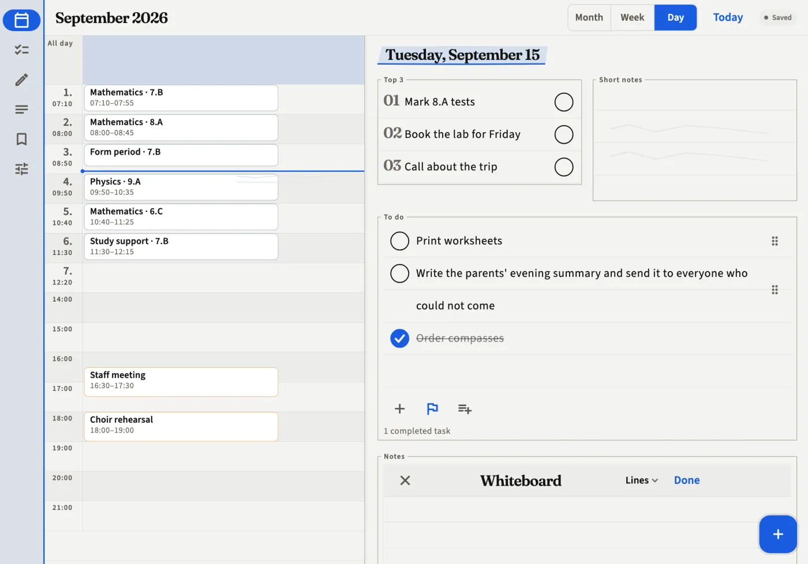

# 2. Mum's idea

[← The question](01-the-question.md) · [Next: The first prototype →](03-first-prototype.md)

My mum is a teacher. Her week is a timetable: lessons, class periods, meetings, parents' evenings. That timetable lives in the school's Outlook calendar. Her notes live somewhere else: a paper planner, a notes app, a notebook app on the iPad, loose PDFs, sticky notes.

Her wish was simple: an app with her **timetable that she can draw on**, kept in sync with her **Google and Outlook calendars**.

Then the project grew. As I built it, I kept getting new ideas and kept finding out that they were actually possible: notebooks, a whiteboard, tasks, widgets, more platforms. The first wish stayed at the centre, and it unpacked into a few rules:

- **Mirror the calendar she already has.** Outlook first (through a published calendar link), later Google and any other calendar link. Never make her re-enter events.
- **Notes next to the calendar, not inside it.** A note about a lesson belongs to *her*, not to the school's calendar. So notes are stored in NorthStar and **never written back to Outlook**. This rule never changed.
- **Handwriting first.** Apple Pencil on the iPad is the main way in. Typing is the fallback.
- **Every device.** iPad first, then iPhone, then the web on her Windows laptop, later Android, Mac and Windows apps.
- **It must keep working when the internet does not.** School Wi-Fi is not always kind. The app must work offline and catch up later, and it must never lose what she wrote.

## Planning before building

I spent the first two days (21 and 22 August 2026) only planning. No app code at all, by choice. I wrote down:

- a **product brief** (what it is, for whom, the "v1 works" test),
- a **data design** (days, events, notes, notebooks, tasks),
- a **sync contract** (how devices and the server talk, and what happens when things go wrong),
- **milestones** (M1 to M8),
- and a **design spec** with strict rules (paper colours, one accent colour, real typography, no gimmicks).

The "v1 works" test was one sentence, and I still like it:

> She plans a full school week on iPad with ink, sees it on her phone and laptop, the server goes down for a day, and nothing is lost or blocked.

The design references were a mix of paper planners, a handwritten week grid with Slovenian day names (PON, TOR, SRE, ČET, PET), minimal to-do apps, and classic daily planners with an hour grid on the left and Top 3, to-do and notes on the right. That last layout became the Day view and has stayed the heart of the app ever since.

*Almost all screenshots in this repository use invented demo data: a made-up school week, made-up names and made-up notes. The few exceptions are marked.*

[Next: The first prototype →](03-first-prototype.md)
