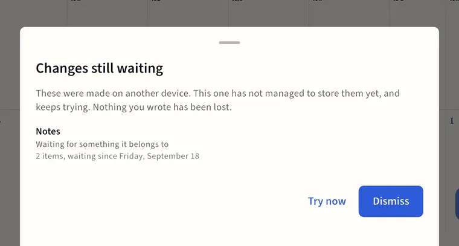
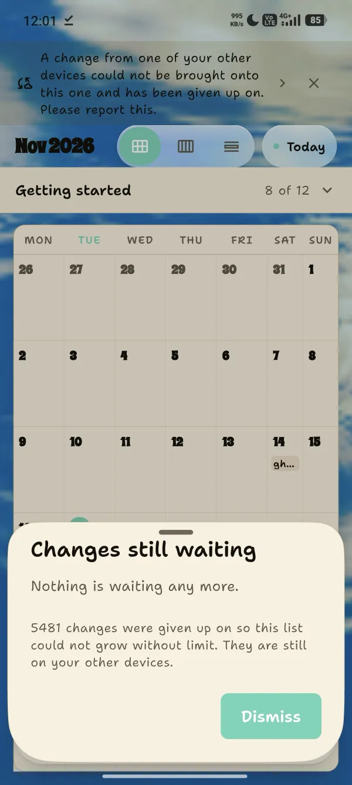
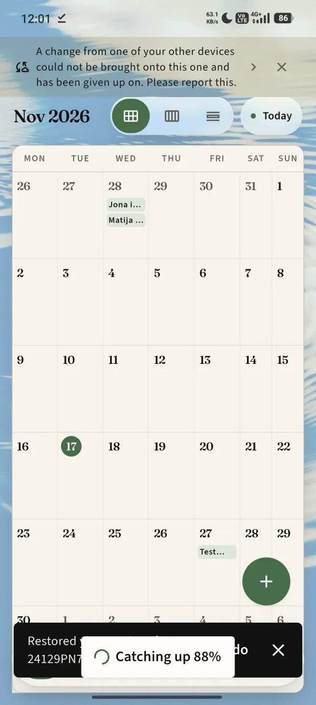

# 4. Sync and the server

[← The first prototype](03-first-prototype.md) · [Next: The calendar →](05-calendar.md)

If handwriting was the first hard problem, sync was the longest one. "It has to be the same on the iPad, the phone and the laptop" sounds simple. It is not.

## The choices

- **My own server.** Notes are private, and I did not want them in someone else's cloud. NorthStar has its own sync server written in Dart, a database and its own sign-in service, all running on a small home server.
- **Offline first.** Every device keeps a complete local copy. You write, it saves locally at once, and a background sync sends the change when it can. The server being down for a day must not block anything.
- **Every change is a small operation**, queued on the device and sent in order. The server gives each one a sequence number, so other devices can ask "what changed since number N?".
- **Pictures, PDFs and stickers travel separately** from the text and ink, as files, so one big picture does not hold up a page of notes.
- **Polling, not push.** I looked at keeping a live connection open, but the path between the internet and my server drops idle connections, so devices ask for changes instead. When the app is open they ask often, so changes arrive in seconds.

## Where it went wrong

Sync bugs are sneaky because they rarely crash. Things just do not arrive. A few real ones:

### Her two devices stopped syncing, silently (3 September)

After an account was deleted and created again, the devices still remembered the old one. The server politely refused their changes, and the app did not show it. Both devices looked fine. Nothing moved.

**Learned:** a refusal from the server is news, not noise. The app now shows a sync problem instead of hiding it.

### One picture blocked everything (7 to 8 September)

A picture left over from another account sat at the front of the upload queue. It could never be uploaded, and everything behind it waited forever: notes, stickers, whole notebooks. The release note for that fix is one of my favourites: *"The upload queue could get stuck for good. It cannot any more."*

**Learned:** a queue needs a way to retire an item that can never succeed, without losing it.

### "Everything is saved", when it was not (14 to 16 September)

The status chip said "Saved" while changes were still on the device. That is worse than no status at all. A whole round of work went into what I called *no silent loss, no silent stall*: the app tells the truth about what has and has not been sent, and changes reach other devices in seconds instead of minutes.

### Mum's iPhone: "your work is not leaving this device" (October and November)

Her iPhone fell far behind the server and kept pushing a long backlog it could never finish. Fixing it meant smarter catch-up: reading changes in pages with a size budget, so a phone with a lot of handwriting can catch up in pieces. Version **1.3.10** (16 October): *"Sync on iPhone is fixed, writing is never lost when you leave a notebook."*

### Deletes that came back

A deleted to-do could reappear when an old device woke up and sent its stale copy. The rule became: **a delete wins**, and among real edits the newest change wins (version 1.2.5).

## What I learned

- **Test sync with two real devices**, not only with tests. Most of these bugs needed a real iPad and a real phone to show up.
- **Every sync fix gets a second careful look**, because a sync bug costs someone their notes.
- **Honesty is a feature.** "Changes still waiting, nothing you wrote has been lost" is more reassuring than a green tick that lies.

## Sync bugs, in pictures

Two real screens from my own test phone in November, and the signed-out notice from 1.3.2. The first one is what a phone showed after an old backlog had to be cut off: the changes still existed on the other devices, but this phone gave up on them and said so.

| Changes given up (17 Nov) | Banners on top of each other (17 Nov) | 1.3.2: signed out, nothing lost |
|---|---|---|
|  |  |  |

[Next: The calendar →](05-calendar.md)
