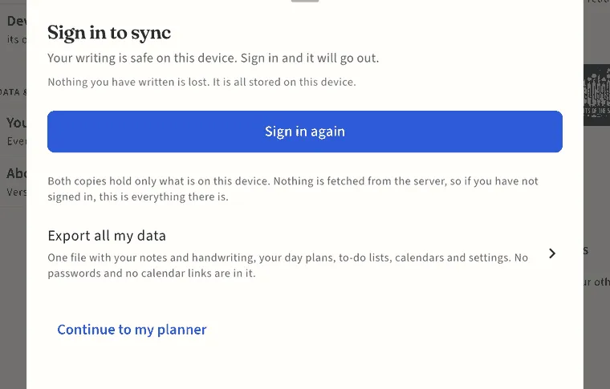

# 4. Sync and the server

[← The first prototype](03-first-prototype.md) · [Next: The calendar →](05-calendar.md)

Handwriting was the first hard problem. Sync was the longest one. "It has to be the same on the iPad, the phone and the laptop" sounds simple. It is not.

## How I set it up

I wanted my own server. Notes are private, and I did not want them in someone else's cloud. So NorthStar has its own sync server written in Dart, a database and its own sign-in service, all running on a small home server.

Every device keeps a complete local copy. You write, it saves on the device straight away, and a background sync sends the change when it can. If the server is down for a day, nothing is blocked.

Every change is a small operation. It waits in a queue on the device and gets sent in order. The server gives each one a sequence number, so another device can ask "what changed since number N?".

Pictures, PDFs and stickers travel separately from text and ink, as files. That way one big picture can't hold up a page of notes.

Devices ask the server for changes instead of the server pushing them. I looked at keeping a live connection open, but the path between the internet and my server drops idle connections. While the app is open the devices ask often, so changes still arrive in seconds.

## Where it went wrong

Sync bugs are sneaky because they rarely crash. Things just don't arrive. Here are a few real ones.

### Her two devices stopped syncing, silently (3 September)

An account got deleted and created again, and the devices still remembered the old one. The server politely refused their changes, and the app showed nothing. Both devices looked fine. Nothing moved.

I had treated a refusal from the server as noise. It is news. Now the app shows a sync problem instead of hiding it.

### One picture blocked everything (7 to 8 September)

A picture left over from another account sat at the front of the upload queue. It could never be uploaded, so everything behind it waited forever: notes, stickers, whole notebooks. The release note for the fix is one of my favourites: *"The upload queue could get stuck for good. It cannot any more."*

The queue needed a way to set aside an item that can never succeed, without losing it.

### "Everything is saved", when it was not (14 to 16 September)

The status chip said "Saved" while changes were still sitting on the device. That is worse than no status at all. I spent a whole round of work on what I called *no silent loss, no silent stall*. The app tells the truth about what has and hasn't been sent, and changes reach other devices in seconds instead of minutes.

### Mum's iPhone: "your work is not leaving this device" (October and November)

Her iPhone fell far behind the server and kept pushing a long backlog it could never finish. To fix it I had to make catch-up smarter. The phone now reads changes in pages with a size budget, so even a phone with a lot of handwriting can catch up in pieces. Version 1.3.10 (16 October): *"Sync on iPhone is fixed, writing is never lost when you leave a notebook."*

### Deletes that came back

A deleted to-do could show up again when an old device woke up and sent its stale copy. Since version 1.2.5 a delete wins. Among real edits, the newest change wins.

## What I took from all this

Most of these bugs only showed up with a real iPad and a real phone in my hands. Tests alone didn't find them, so now I always test sync on two real devices.

Every sync fix also gets a second careful look before it goes out. A sync bug costs someone their notes.

And I'd rather the app be honest than pretty. "Changes still waiting, nothing you wrote has been lost" calms people down more than a green tick that lies.

## Sync bugs, in pictures

Two real screens from my own test phone in November, and the signed-out notice from 1.3.2. The first one is what a phone showed after an old backlog had to be cut off. The changes still existed on the other devices, but this phone gave up on them and said so.

| Changes given up (17 Nov) | Banners on top of each other (17 Nov) | 1.3.2: signed out, nothing lost |
|---|---|---|
|  |  |  |

[Next: The calendar →](05-calendar.md)
