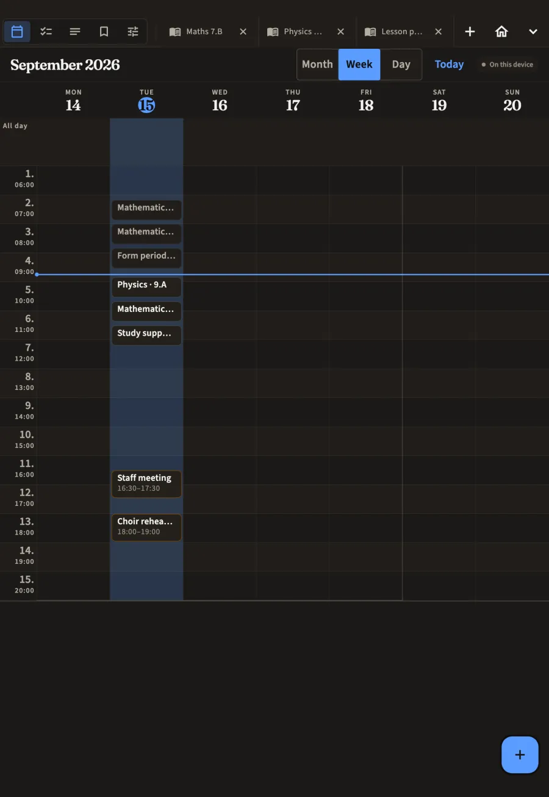
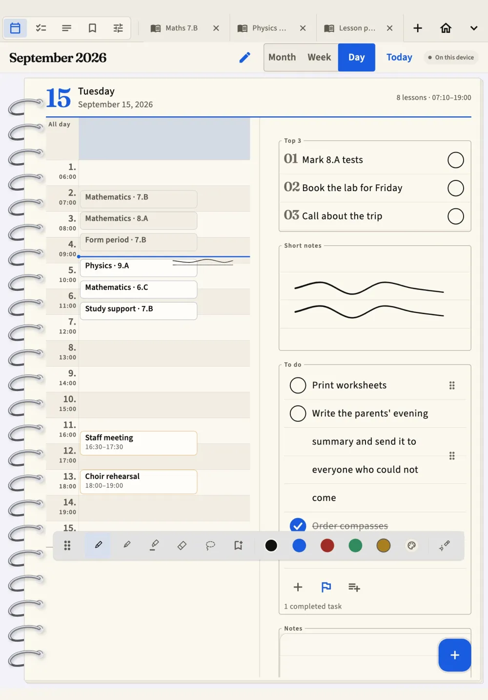
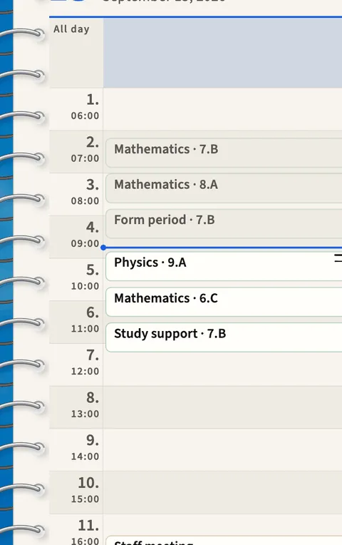
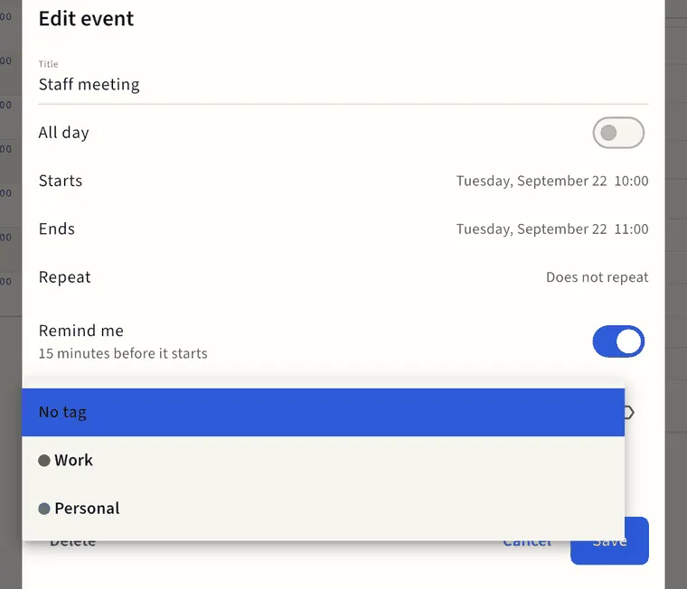
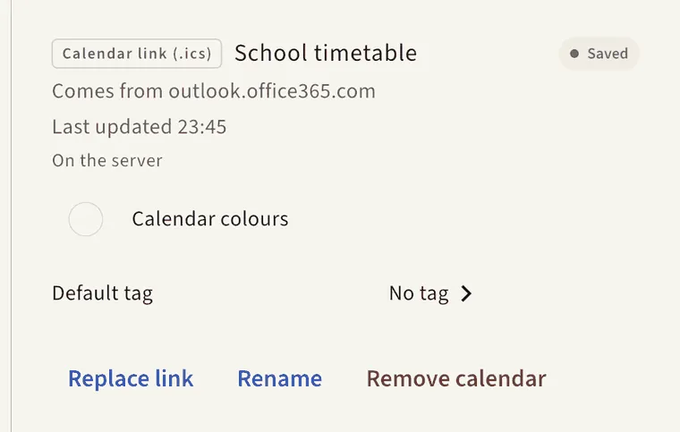
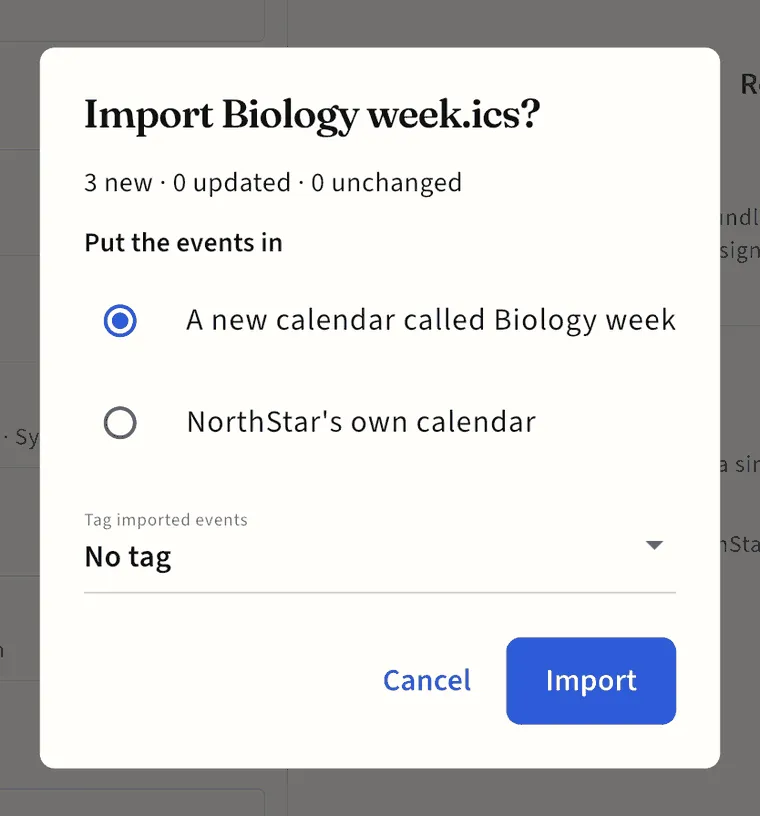

# 5. The calendar

[← Sync and the server](04-sync-and-the-server.md) · [Next: Handwriting and notebooks →](06-handwriting-and-notebooks.md)

NorthStar is not a calendar service. It shows the calendars you already have and lets you plan around them.

## Where events come from

Calendar links (ICS) were the first source and are still the most important one. Outlook can publish a calendar as a link, and NorthStar reads that link on a schedule. The same thing works for school timetables, iCloud and anything else that gives you a link. Since 1.3.9 the link doesn't even have to end in `.ics`.

Then there is Google Calendar. You sign in with Google and pick which calendars to show, and you can create and edit Google events from NorthStar. Two Google accounts side by side arrived in 0.14.0.

You can also import a calendar file once, or export one (1.3.3). You can create events that live only in NorthStar and sync to your devices. And Slovenian public holidays come with the app, behind one switch.

One rule never changed. Your notes are never written into these calendars. Outlook gets nothing back from NorthStar.

## A school timetable

Ordinary calendars show hours. A teacher thinks in lessons: 1st period at 07:10, 2nd at 08:00, a long break, and so on. So the Day and Week views use a lesson grid with numbered periods and real bell times during school hours, and plain hours after school. You can set the number of lessons, the first period, named rows before it and all the times.

## Things that were harder than they look

Repeating events only came in September, which is later than I expected. Editing one occurrence versus the whole series, and doing it the same way Google does, needed a lot of care.

Once a day split into two copies of itself. Two devices both created "the note for Tuesday" while offline. When they synced, Tuesday had two notes. The fix merges them, and the rule now is one day, one note.

On iPad the same calendar could show up twice after a reconnect. That was fixed in 2.9.0.

Overlapping events used to hide each other on busy days. Since 2.5.1 they all show side by side.

And if a calendar link stops working, the app warns you. Before, it would just keep showing an old week.

## The planner page

In version 2.1.0 (28 October) the Day view got a second look, a planner page. It looks like a paper planner on a desk, with a printed date block and spiral binding. It's optional, and the plain look is still there.

| Planner page | Spiral detail |
|---|---|
|  |  |

## How the calendar settings changed

From the 1.x settings card, to Google calendars and calendar files, to tags and crowded days.

| 1.1: tags on events | 1.3: the calendar card | 1.3: Google calendars and holidays |
|---|---|---|
|  |  |  |
| **1.3.3: import a calendar file** | **1.3.19: crowded days** | **2.1: Top 3 that wraps** |
|  |  |  |

[Next: Handwriting and notebooks →](06-handwriting-and-notebooks.md)
