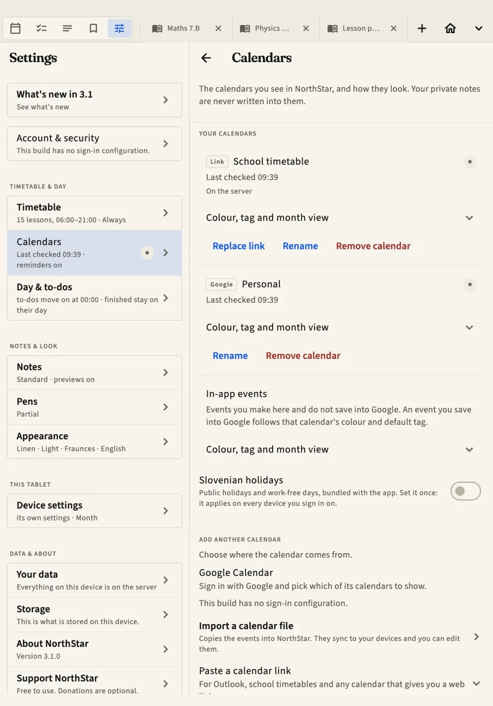
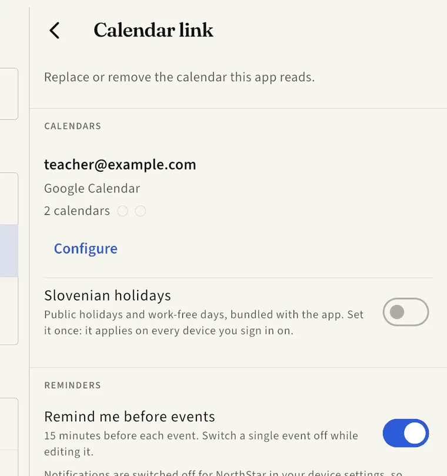
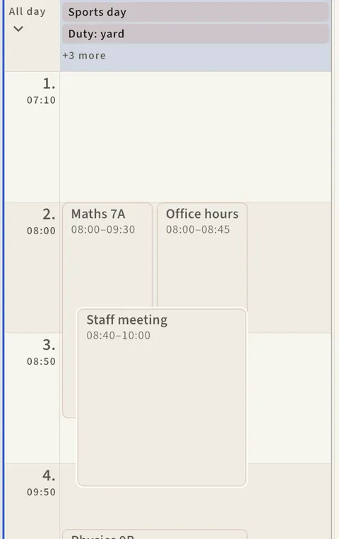
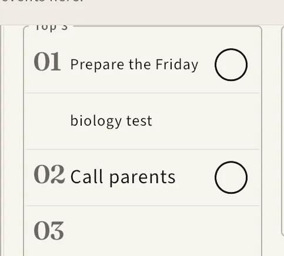

# 5. The calendar

[← Sync and the server](04-sync-and-the-server.md) · [Next: Handwriting and notebooks →](06-handwriting-and-notebooks.md)

NorthStar is not a calendar service. It **mirrors** the calendars you already have and puts your own planning around them.

## Where events come from

1. **Calendar links (ICS).** This was the first and is still the most important source. Outlook can publish a calendar as a link, and NorthStar reads it on a schedule. It works for school timetables, iCloud and anything else that gives you a link (from 1.3.9 even links that do not end in `.ics`).
2. **Google Calendar.** Sign in with Google, pick which calendars to show, and you can create and edit Google events from NorthStar. Two Google accounts side by side arrived in 0.14.0.
3. **Calendar files.** Import a calendar file once, or export one (1.3.3).
4. **In-app events.** Events you create only in NorthStar, synced to your devices.
5. **Slovenian public holidays**, bundled with the app, one switch.

And the one rule that never changed: **your notes are never written into these calendars.** Outlook gets nothing back from NorthStar.

## A school timetable, not just hours

Ordinary calendars show hours. A teacher thinks in **lessons**: 1st period 07:10, 2nd 08:00, a long break, and so on. So the Day and Week views use a lesson grid with numbered periods and real bell times for school hours, and plain hours after school. The number of lessons, the first period, named rows before it and the times are all configurable.

## Things that were harder than they look

- **Repeating events** (September) came surprisingly late, because editing one occurrence versus the whole series, and doing it the same way Google does, needed a lot of care.
- **A day split into two copies of itself.** Two devices created "the note for Tuesday" at the same time while offline. When they synced, Tuesday had two notes. The fix merges them, and the rule is now: one day, one note.
- **Twin calendars on iPad** (2.9.0). The same calendar could show up twice after a reconnect.
- **Busy days.** Overlapping events used to hide each other. From 2.5.1 every overlapping event shows side by side.
- **Calendar links that silently stop.** If a link stops working, the app warns you instead of quietly showing an old week.

## The planner page

In version 2.1.0 (28 October) the Day view got a second look: a **planner page**, like a paper planner on the desk, with a printed date block and spiral binding. It is optional, the plain look stays.

| Planner page | Spiral detail |
|---|---|
|  |  |

## How the calendar settings evolved

From the 1.x settings card, to Google calendars and calendar files, to tags and crowded days.

| 1.1: tags on events | 1.3: the calendar card | 1.3: Google calendars and holidays |
|---|---|---|
|  |  |  |
| **1.3.3: import a calendar file** | **1.3.19: crowded days** | **2.1: Top 3 that wraps** |
|  |  |  |

[Next: Handwriting and notebooks →](06-handwriting-and-notebooks.md)
