# 7. Design: from Classic paper to Glass

[← Handwriting and notebooks](06-handwriting-and-notebooks.md) · [Next: Widgets and everywhere →](08-widgets-and-everywhere.md)

## The first rules

The design spec from the planning days was strict, almost stubborn:

- warm off-white **paper** colours, ink-black text, **one** accent blue,
- a serif display font for dates and titles, a calm humanist sans for everything else,
- hairline rules instead of boxes inside boxes,
- and a list of banned things: gradients, glowing blobs, emoji as icons, neon, and specifically **"glassmorphism or frosted blur"**.

Keep that last one in mind.

The paper look grew through September and October. The dark theme stayed close to the first prototype, with tabs added on top when several notebooks could be open at once (2.6.0):

| Dark, with tabs | Paper, with a writing area in the day |
|---|---|
|  |  |

## Why Glass

By November the app did a lot, and it looked like it: bars, panels, borders, more bars. It felt heavy, especially on a big iPad screen. At the same time Apple's own apps had moved to translucent, layered "glass" surfaces, and NorthStar started to look old next to them.

So the rule from August was overturned. Not because the old rule was wrong, but because the app had changed. The new idea:

> The **controls** float on glass over a background. **Your pages stay paper.**

Your notes, timetable and notebooks never become see-through. Only the bars, menus and panels do.

## Eight rounds in five days

The Glass design landed on **10 November** as the new default, with Classic kept as an option, and then went through round after round of fixes:

- **Round 2 to 3:** dialogs, the pen sheet, typed notes, one pen toolbar everywhere, glass popups.
- **Round 4:** glass over *any* background, a notebook "desk", and the page curl put back (see [chapter 6](06-handwriting-and-notebooks.md#the-page-curl-story)).
- **Round 5:** Classic must look exactly like Classic again, not like "Glass with the glass turned off".
- **Round 6 to 7:** transparent backgrounds, full-bleed documents, a live 0 to 100 glass slider.
- **Round 8:** real frosted glass, like the preview I had picked, with one shared wallpaper.

Version **3.3.0** shipped it on **14 November**: *"New appearance: Glass design, shared backgrounds, adjustable frost and palette-matched planner pages."*

| Classic | Glass |
|---|---|
|  | 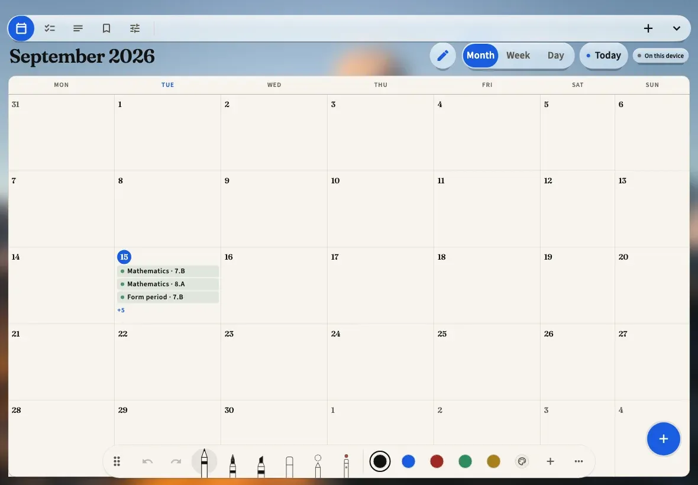 |

| Glass, dark | Glass Day view |
|---|---|
|  |  |

| Glass tasks | Appearance settings |
|---|---|
|  |  |

Notebooks in Glass: the page sits on the desk, the controls float above it.

| Notebook with page strip | Selection on a page |
|---|---|
|  |  |

## Glass without the cost

Frosted blur is expensive to draw, and an iPad drawing a blur behind every bar while you write would ruin the pen latency from [chapter 1](01-the-question.md). The solution was to blur the background once, keep it, and let every glass surface sample that saved blur instead of blurring live. No blur inside a blur, and the Day and Month views ended up with no live blurs at all.

## Accessibility

- **Reduce Transparency** in iOS settings turns the bars solid.
- The **glass amount** slider goes from 0 (solid, like Classic) to 100.
- Layouts were checked with text sizes from 100 % to 200 % and with every app font, down to a narrow phone.

**Learned:** design rules are tools, not laws. Write down *why* each rule exists, so that when the situation changes you know which rule can go.

## From Classic to Glass, step by step

Settings in 1.1, the 3.0 look with the new tab bar, the design targets the Glass rounds were measured against, and real-device shots from the rounds after 3.3.

| 1.1: appearance settings | 3.0: Day with the tab bar | 3.0: Month with spirals |
|---|---|---|
|  | 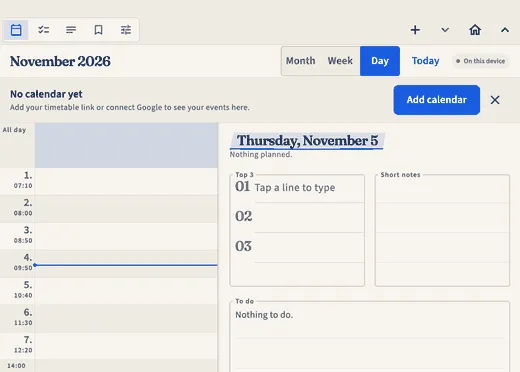 | 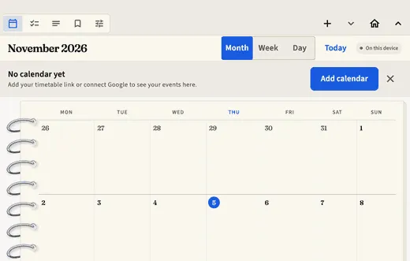 |
| **3.0: documents with covers** | **Glass target: Month** | **Glass target: notebook** |
| 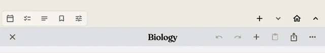 | 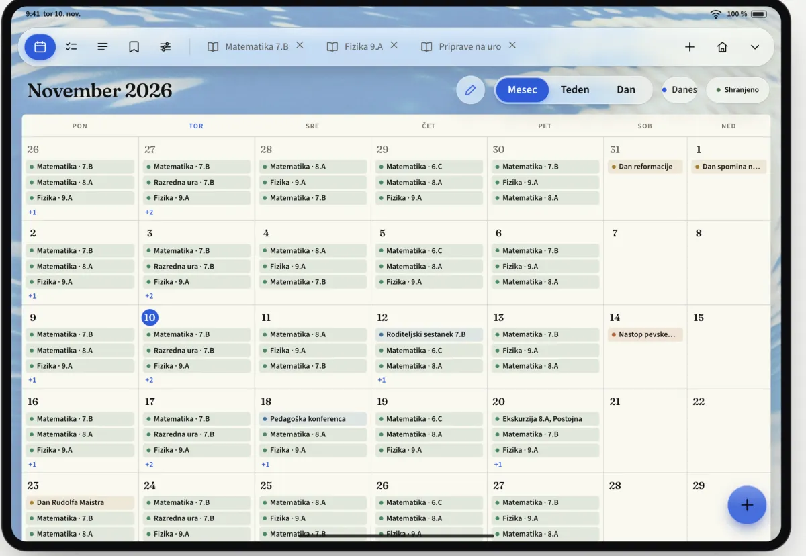 | 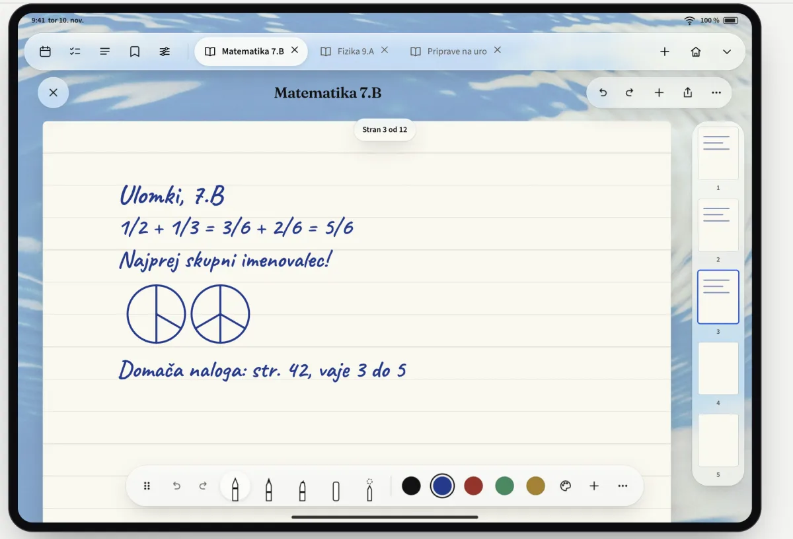 |
| **Glass target: tasks** | **Glass target: typed note** | **Tasks before round 9** |
| 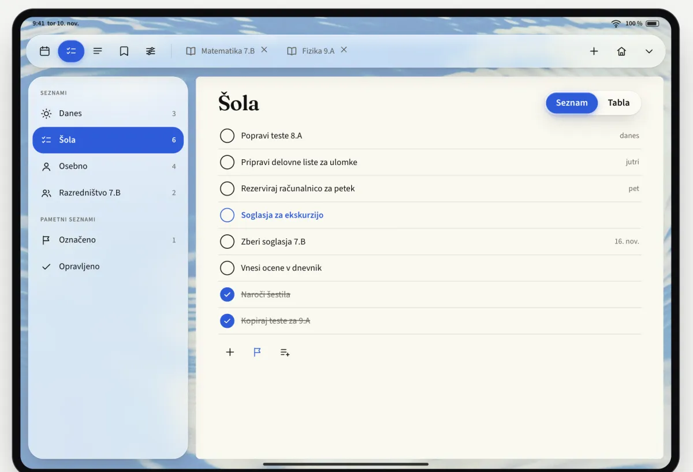 |  |  |
| **Documents before round 9** | **Spiral month on a real iPad** | **A curtain that got removed** |
|  |  | 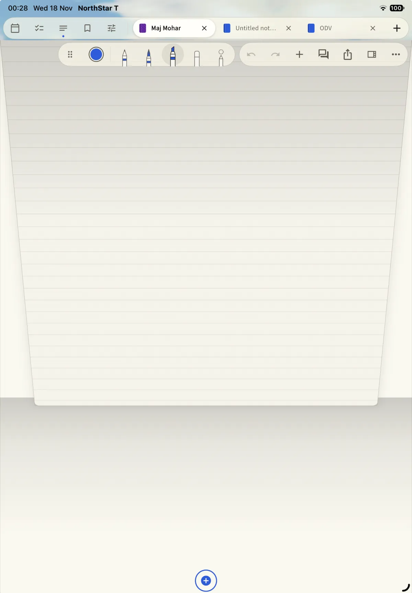 |

## The Glass rounds on a real iPad

Before-shots from the rounds: what the screens looked like before round 4, an edit sheet from round 8, and a bug where glass amount 0 still was not solid.

| Month before round 4 | Documents before round 4 | Tasks before round 4 |
|---|---|---|
| 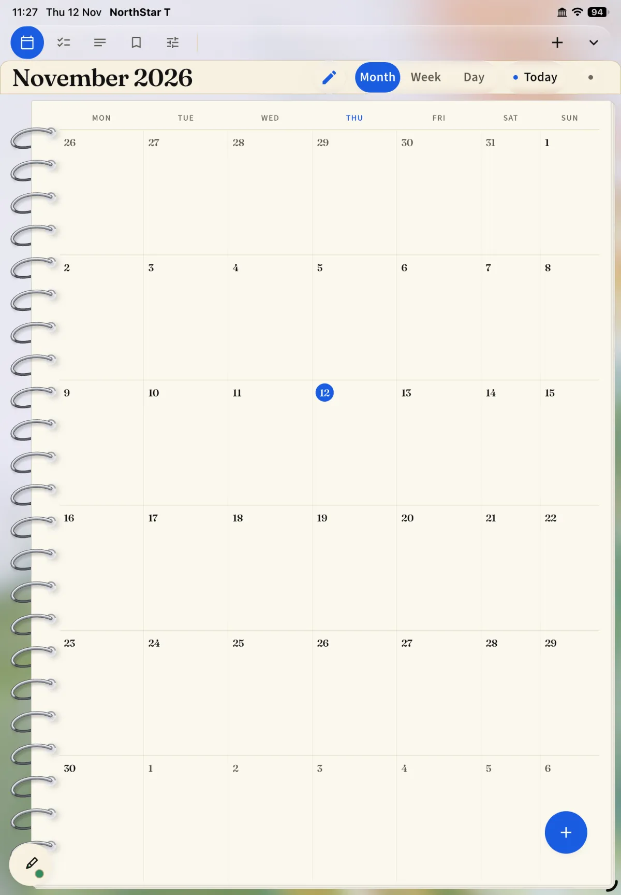 |  |  |
| **Stickers before round 4** | **Edit event, round 8** | **Glass amount 0 bug (email hidden)** |
| 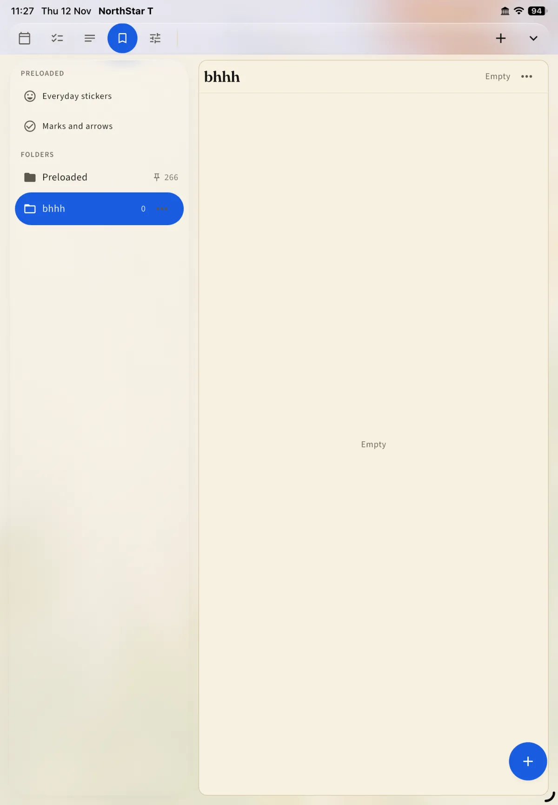 | 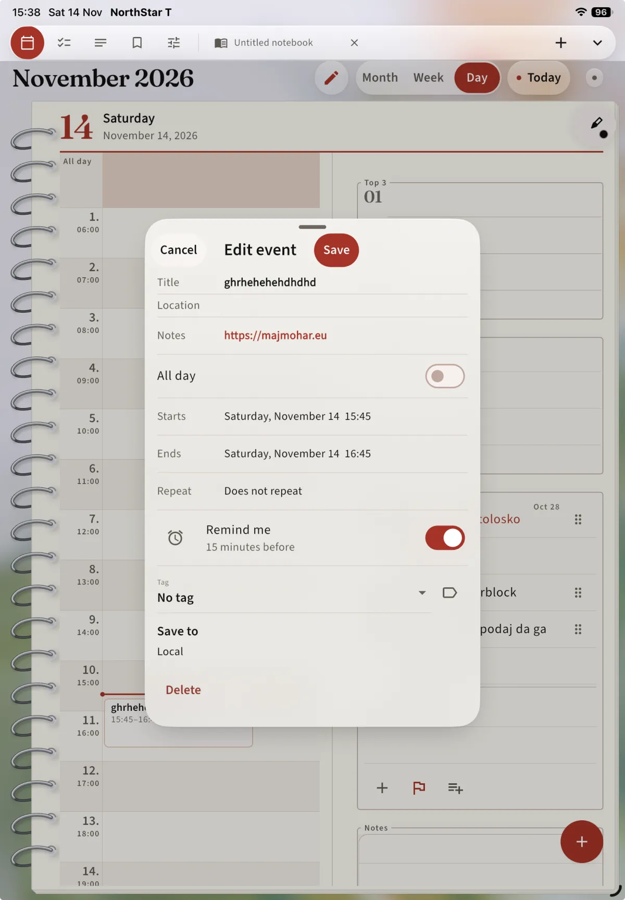 | 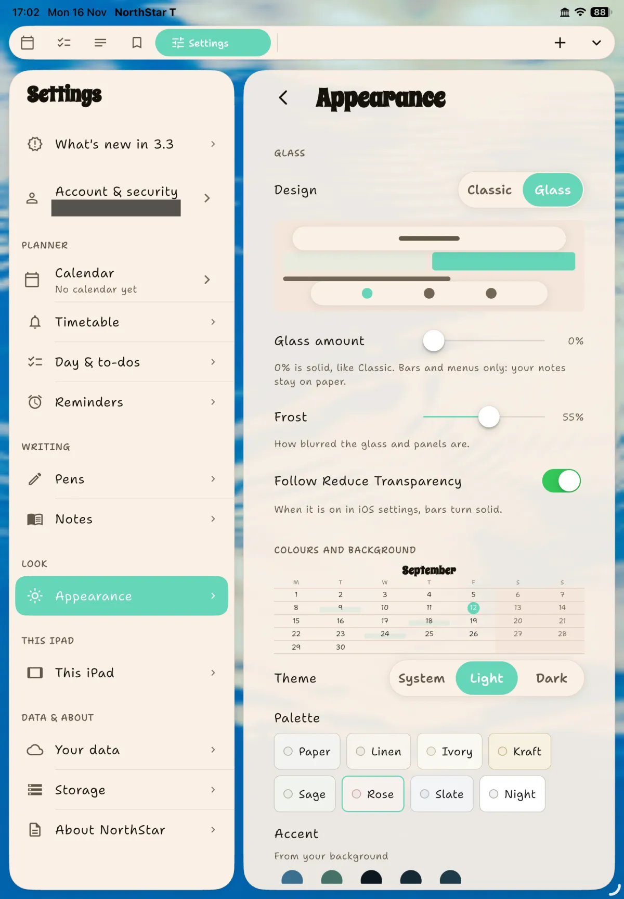 |

[Next: Widgets and everywhere →](08-widgets-and-everywhere.md)
