# 8. Widgets and everywhere

[← Design and Glass](07-design-and-glass.md) · [Next: Polish and feedback rounds →](09-polish-and-feedback-rounds.md)

"The same on the iPad, the phone and the laptop" turned into six platforms and a set of Home Screen widgets.

## Platforms, in the order they arrived

| When | Platform | Notes |
|---|---|---|
| August | **iPad** and **iPhone** | The main devices from day one. |
| August | **Web** | For the laptop. Installable as an app, works offline after the first load. |
| 1 September | **Android** | Adaptive icon, its own widgets, updates itself. |
| 2 September | **macOS** | The iPad layout on a big screen, with keyboard and trackpad. |
| November | **Windows** | A native Windows build, plus the web app with a stylus. |

One Flutter codebase covers all of them. The differences are small native pieces: widgets, share sheets, notifications, the Apple Pencil squeeze, file pickers.

Since 1.3.8 (5 October) NorthStar can update itself on Android, on the web and on the Mac outside the stores. That meant my mum always had the latest fixes without having to ask me.

A second Mac at home pulls the latest version, runs the tests and builds the apps on a schedule. So a weekly build is ready even when I'm busy.

## Windows and the pen

The web app on a Windows laptop with a stylus is where a pen behaves least like the Apple Pencil from [the blank-page test](01-the-question.md). And it showed. In November I tested on a Windows laptop with a pen and found that tabs could not be closed or even clicked. The stylus was read as a long press with the mouse, so the browser opened its context menu. Sometimes a pen lift never arrived at all, and the stroke just kept drawing.

The fixes were to recover a lost pen lift, to ignore the pen's side button and eraser while the pen is in the air, and to stop the browser's own menu from opening under the pen. I also added a hidden pen debug overlay that I could switch on for my own test account, so I could see exactly what the browser reports.

"A pen" is not one thing. Every platform and every browser reports it differently, and I only found that out on the real hardware.

## Widgets

Home Screen widgets arrived in 0.17.0 (2 September), only twelve days after the first commit. That early, because seeing "what is next today" without opening the app is half the point of a planner.

They have grown a lot since. There is Today, Next event, Top 3, To-do, a notebook shortcut, and a Mix widget that combines them. Widgets can follow tags (since 1.2.0, later several at once). They are written natively for iOS and Android and read a small export that the app prepares for them.

| To-do widget, paper | To-do widget, night |
|---|---|
| 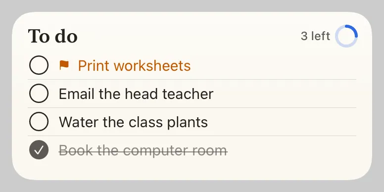 | 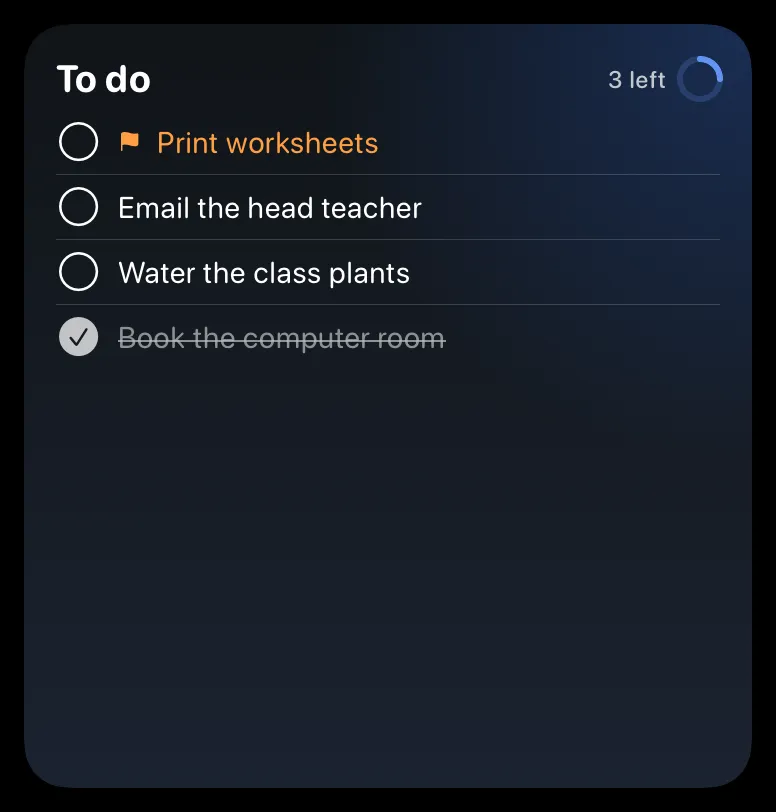 |

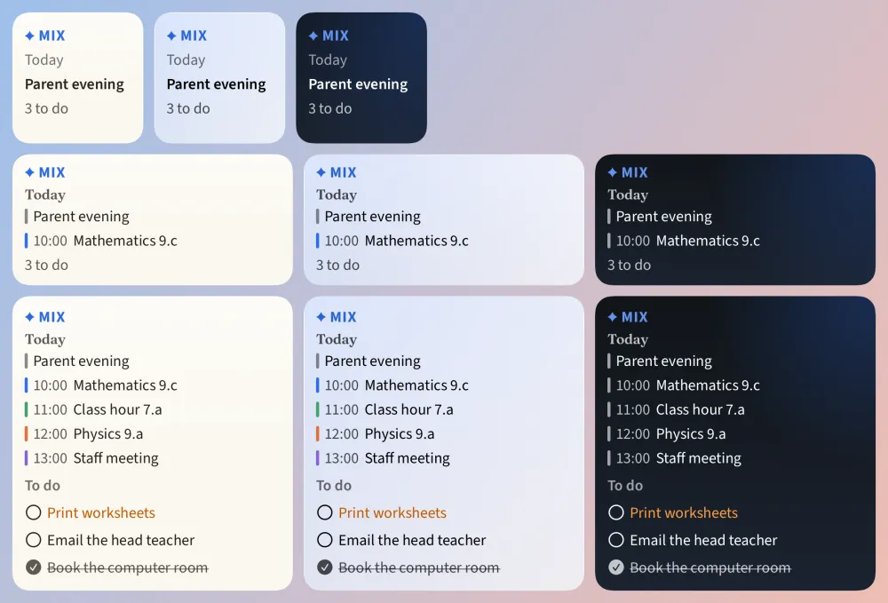

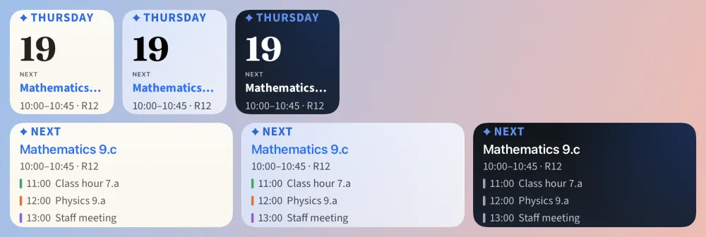

In 3.5.0 (19 November) widgets got styles to match the app: Paper, Night, Glass and Accent, with your own colour.

| Glass style | Accent style |
|---|---|
| 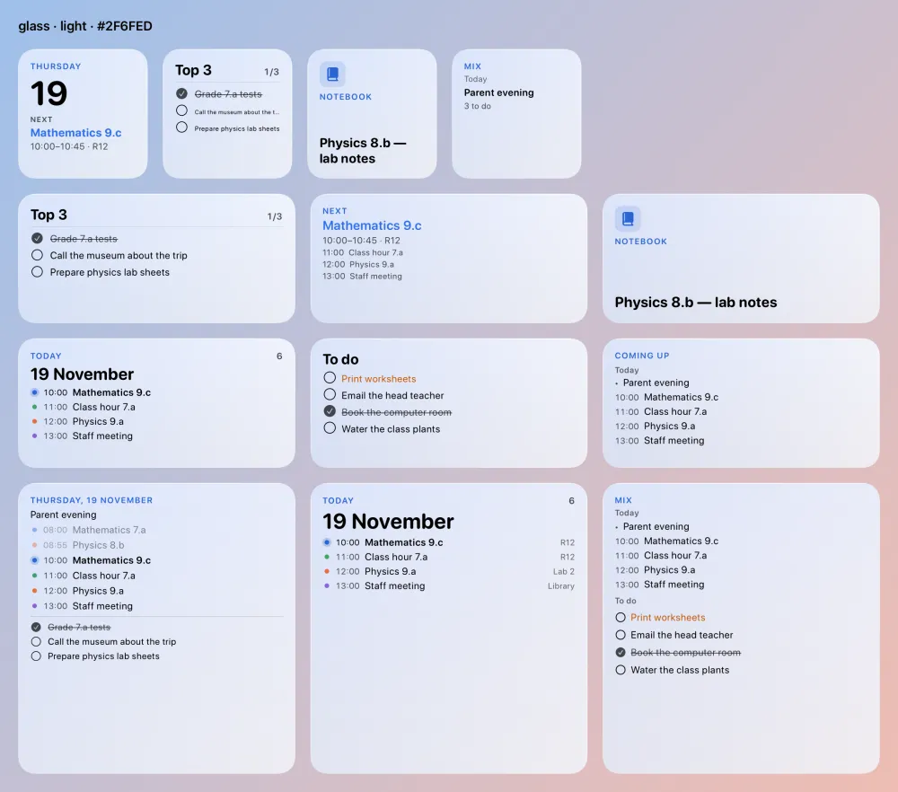 | 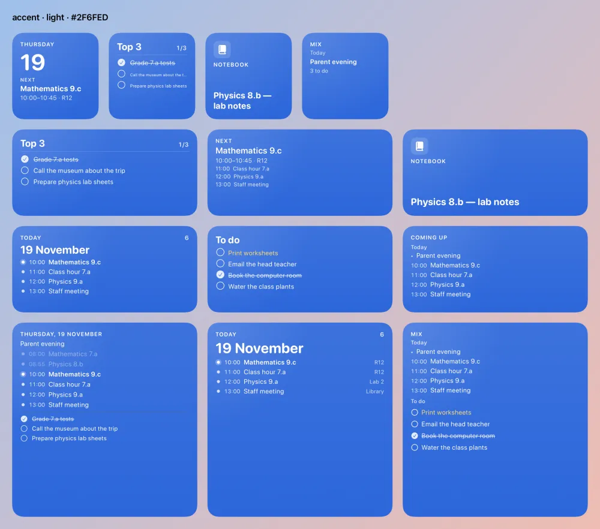 |

## Tasky

Along the way I also made Tasky, a small to-do app of my own. Later it borrowed NorthStar's task structure (folders, smart lists, sub-tasks, flags) and the Glass look.

## Android

The Android app and its widgets on my own test phone, and the update popup from 1.3.8 (the version number in it is a placeholder).

| Today widget | To-do widget | Small Today widget |
|---|---|---|
| 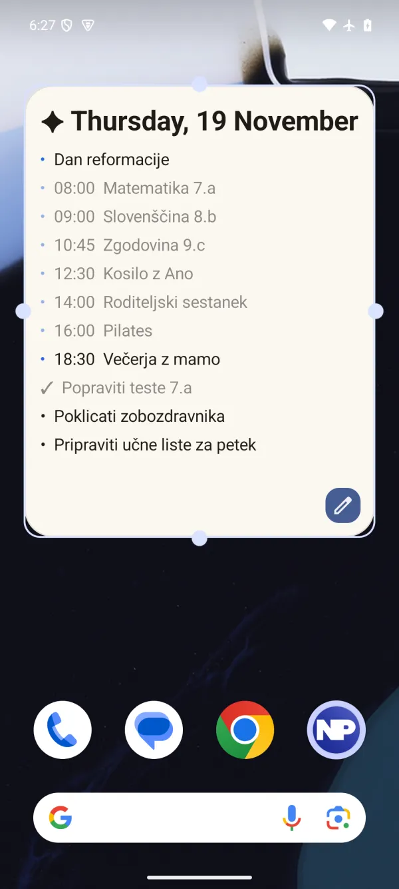 | 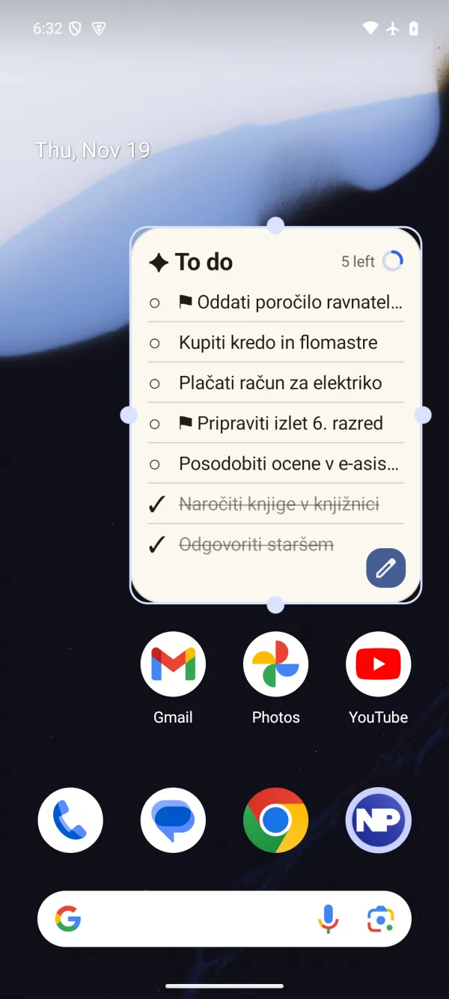 | 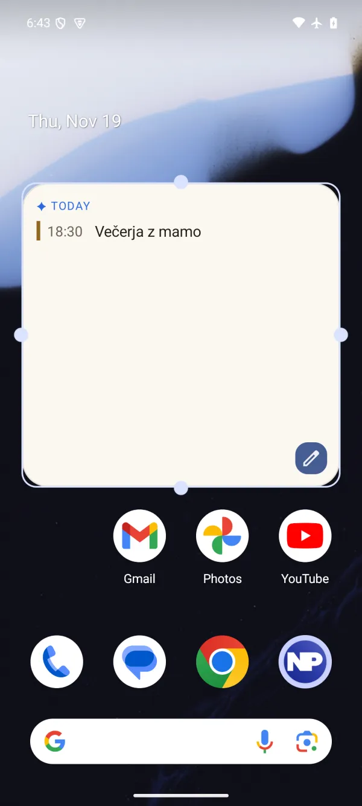 |
| **Android app, first start** | **1.3.8: update popup** | |
| 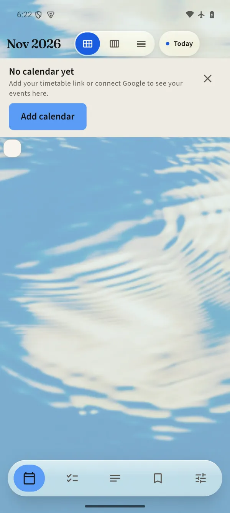 | 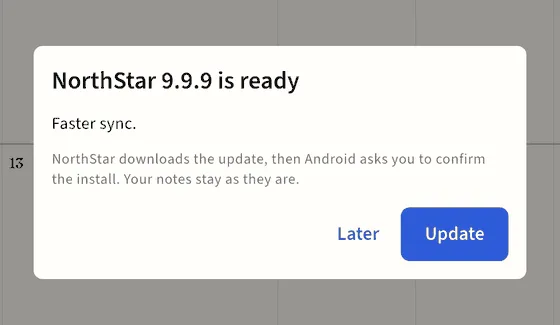 | |

## The Glass design on Android

My Android test phone on 17 November, one day after the Glass rounds.

| Welcome | Sign in | Month, catching up |
|---|---|---|
| 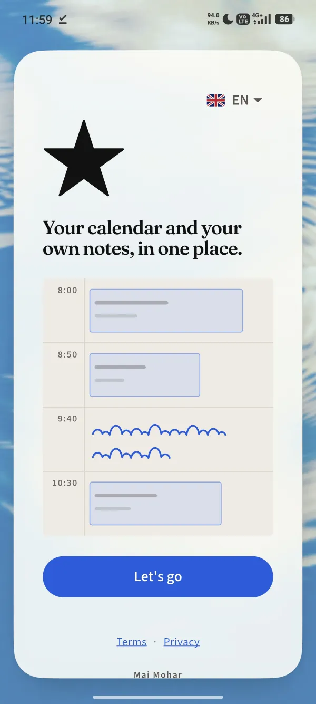 | 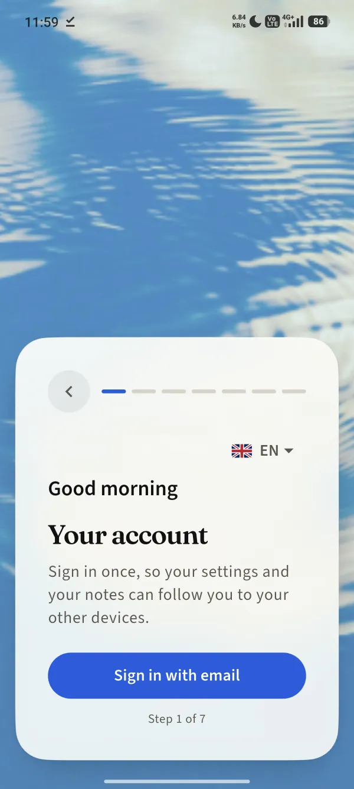 | 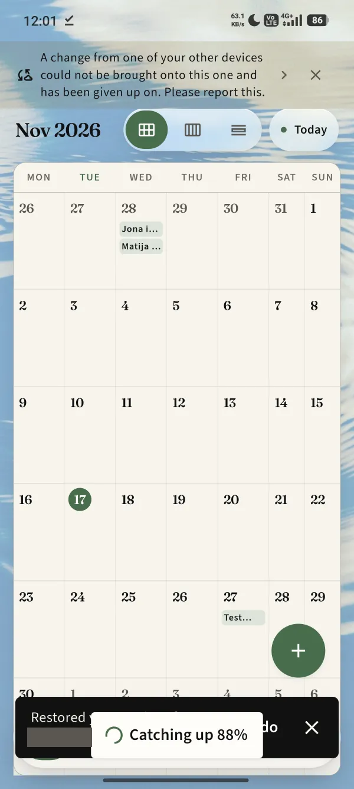 |
| **Changes still waiting** | **Tasks** | **Settings (email hidden)** |
| 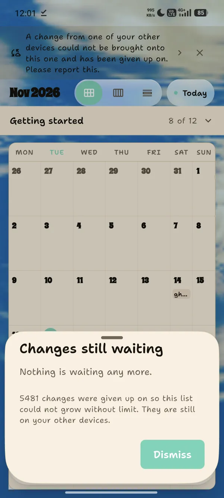 | 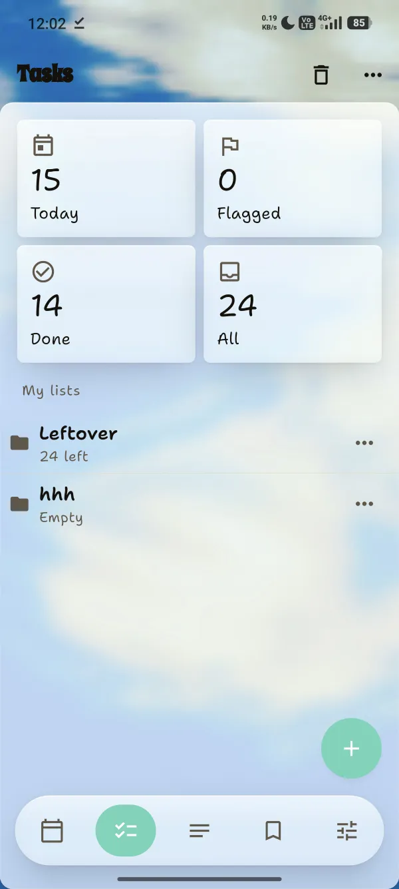 | 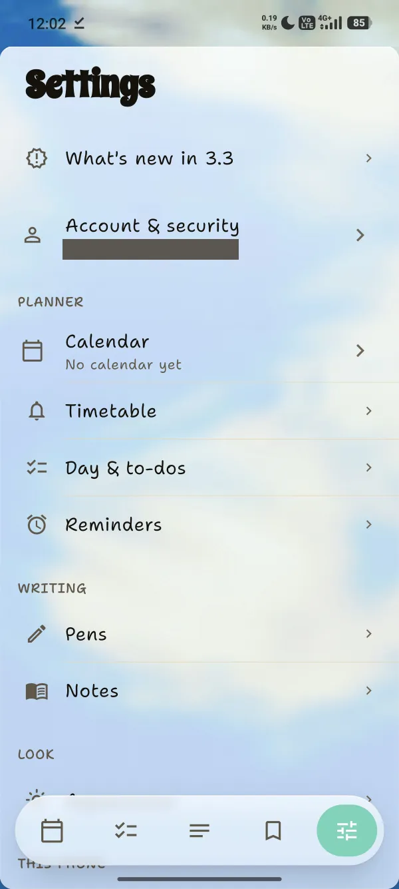 |
| **Appearance, Glass** | **Appearance, Classic** | |
| 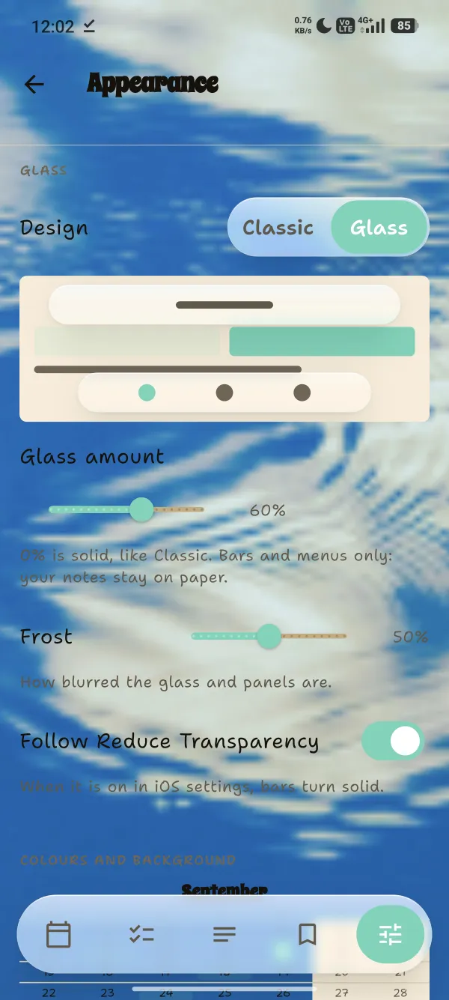 | 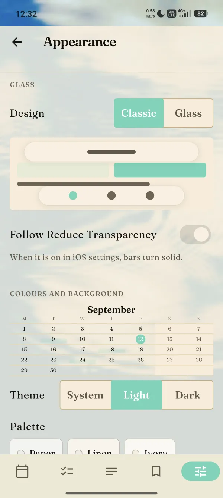 | |

[Next: Polish and feedback rounds →](09-polish-and-feedback-rounds.md)
