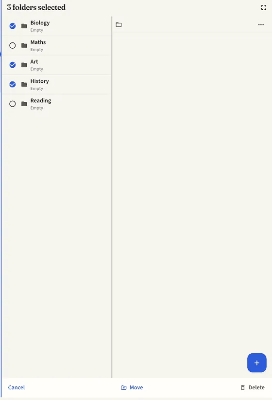

# 9. Polish and feedback rounds

[← Widgets and everywhere](08-widgets-and-everywhere.md) · [Next: Release →](10-release.md)

From September on, NorthStar had a real user who opened it every school day. That changed how I worked.

## How feedback arrived

Mostly in person and by message. "The page does not show the next one while I turn it." "My phone says my work is not leaving the device." "I want to select several sticker folders at once." Short and concrete. She was always right about what was wrong, even when the why took me days.

Since 1.0.3 you can also send a suggestion or report a problem from inside the app, and hear back when it ships.

Sometimes I just got a screenshot from her iPad. I learned to read those three ways: what she sees, what she expected, and what the app thinks is going on.

Every report went on a list. The rule was simple. Every bug found gets fixed, and none is quietly dropped.

## Version 1.0 and Slovenian

1.0.0 came on 21 September, a month after the first commit. The very next releases were about language. 1.0.1: *"The app speaks Slovene everywhere: the screens, the landing page, the welcome mail and the shared page."* Later, in one evening, the hundreds of strings that were still left got translated by hand into natural Slovenian. The app is now fully bilingual, English and Slovenian.

## Rounds

From late October the work came in rounds. A list of everything my mum and I had collected, worked through in one push, released, and then used for a few days to collect the next list. Some of the bigger ones:

- 2.0 (26 October) was the big notebook update. A new pen toolbar, ink that follows dark mode, clearer busy days, and a full-screen *What's new* tour with real pictures.
- 2.4 to 2.5 (3 November) made notebook and PDF scrolling much faster, and added a guided tour that teaches by doing and Getting started in Settings.
- 2.7 to 2.9 (4 November) brought a storage page you can understand and clean, undo for everything in a notebook, and sections in the tab bar.
- 3.0 (5 November) had Open book, one big square whiteboard, simpler pens, and notebook export and import.
- 3.1 (5 November) added a backup file of all your data, notebooks from other notebook apps, a laser pointer, and cover and paper chosen first.
- 3.3 (14 November) was the Glass design ([chapter 7](07-design-and-glass.md)).
- Rounds 9 to 13 (16 to 19 November) covered sideways paging, a cleaner pen toolbar, pictures you can move with a finger while the Pencil writes over them, faster catch-up after a long time offline, editing the cover and paper of an existing notebook, and a long list of small layout fixes.

## Making it faster

Polish is also speed. These are measured numbers from the November rounds, and I like them a lot.

When you lifted the pen, the toolbar used to rebuild 423 times. After the fix it rebuilds 14 times.

A writing session used to render about 95 page pictures. Now it's about 2, drawn only at quiet moments.

Opening a notebook reads a short list of what changed. It used to read every stroke on every page.

## What my mum taught me about this

One real, demanding user is worth a hundred imagined ones. Many of the best features came from watching her use the app: a Top 3 that wraps to two lines, scans that become movable pictures, a page that is already there under the curl.

I also stopped saying "done" too early. A green test suite doesn't mean it works on her iPad. Before a round counted as finished, I checked every ask on the list again, on the real thing.

And I write release notes in plain words. They are written for my mum and not for developers. What changed for you, in one sentence.

## A small ask, a small fix

Many fixes were tiny and came straight from my mum, like selecting several folders at once (1.3.9).

| 1.3.9: select several folders |
|---|
|  |

[Next: Release →](10-release.md)
