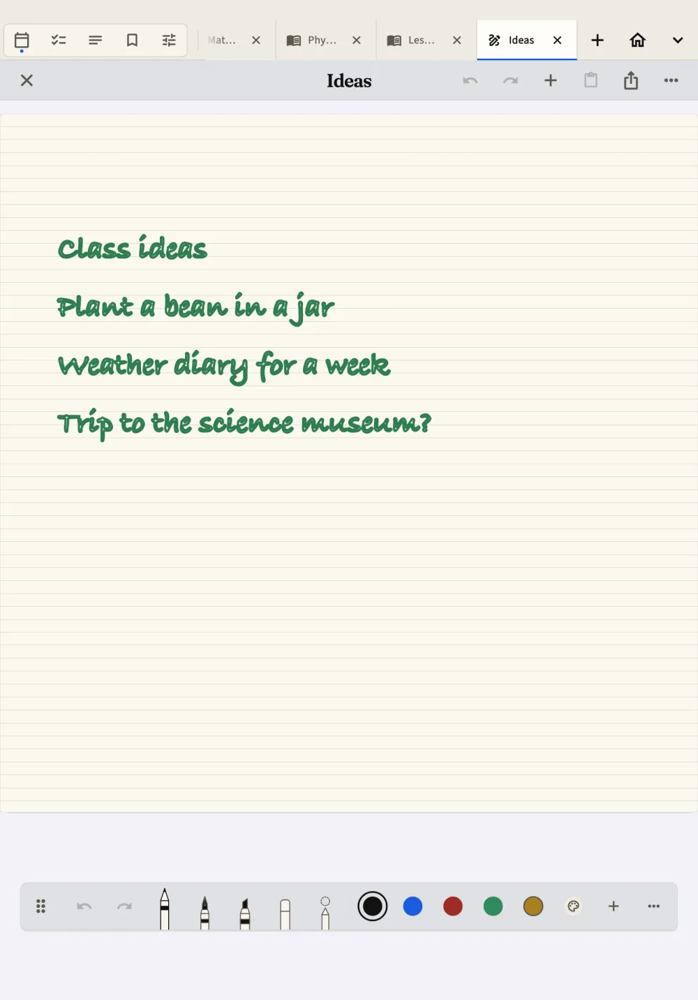

# 9. Polish and feedback rounds

[← Widgets and everywhere](08-widgets-and-everywhere.md) · [Next: Release →](10-release.md)

From September on, NorthStar had a real user who used it every school day. That changed everything about how I worked.

## How feedback arrived

- **In person and by message.** "The page does not show the next one while I turn it." "My phone says my work is not leaving the device." "I want to select several sticker folders at once." Short, concrete, and always right about *what* was wrong, even when the *why* took me days.
- **From inside the app** (1.0.3): send a suggestion or report a problem, and hear back when it ships.
- **A screenshot from her iPad**, read three ways: what she sees, what she expected, and what the app thinks is going on.

Every report went into a list, and the rule was simple: **every bug found gets fixed**, none quietly dropped.

## Version 1.0 and Slovenian

**1.0.0** came on **21 September**, a month after the first commit. The very next releases were about language: 1.0.1 *"The app speaks Slovene everywhere: the screens, the landing page, the welcome mail and the shared page."* Later, in one evening, hundreds of remaining strings were translated by hand into natural Slovenian. The app is fully bilingual, English and Slovenian.

## Rounds

From late October the work came in **rounds**: a list of everything my mum and I had collected, worked through in one push, released, and then used for a few days to collect the next list. A few highlights:

- **2.0 (26 October):** the big notebook update. A new pen toolbar, ink that follows dark mode, clearer busy days, and a full-screen *What's new* tour with real pictures.
- **2.4 to 2.5 (3 November):** much faster notebook and PDF scrolling, a guided tour that teaches by doing, Getting started in Settings.
- **2.7 to 2.9 (4 November):** a storage page you can understand and clean, undo for everything in a notebook, sections in the tab bar.
- **3.0 (5 November):** Open book, one big square whiteboard, simpler pens, notebook export and import.
- **3.1 (5 November):** a backup file of all your data, notebooks from other notebook apps, a laser pointer, cover and paper chosen first.
- **3.3 (14 November):** the Glass design ([chapter 7](07-design-and-glass.md)).
- **Round 9 to 13 (16 to 19 November):** sideways paging, a cleaner pen toolbar, pictures you can move with a finger while the Pencil writes over them, faster catch-up after a long time offline, edit the cover and paper of an existing notebook, and a long list of small layout fixes.

## Performance work

Polish is also speed. Some measured wins from the November rounds:

- When you lift the pen, the toolbar used to rebuild **423** times. After the fix: **14**.
- A writing session used to render about **95** page pictures. After the fix: about **2**, drawn only at quiet moments.
- Opening a notebook reads a short list of what changed instead of every stroke on every page.

## What I learned

- **One real, demanding user is worth a hundred imagined ones.** Many of the best features (Top 3 that wraps to two lines, scans that become movable pictures, a page that is already there under the curl) came from watching her use it.
- **Verify before saying "done".** A green test suite does not mean it works on her iPad. Before a round counted as finished, every ask on the list was checked again, on the real thing.
- **Release notes in plain words.** Every release note is written for my mum, not for developers: what changed for *you*, in one sentence.

## A small ask, a small fix

Many fixes were tiny and came straight from my mum, like selecting several folders at once (1.3.9).

| 1.3.9: select several folders |
|---|
|  |

[Next: Release →](10-release.md)
